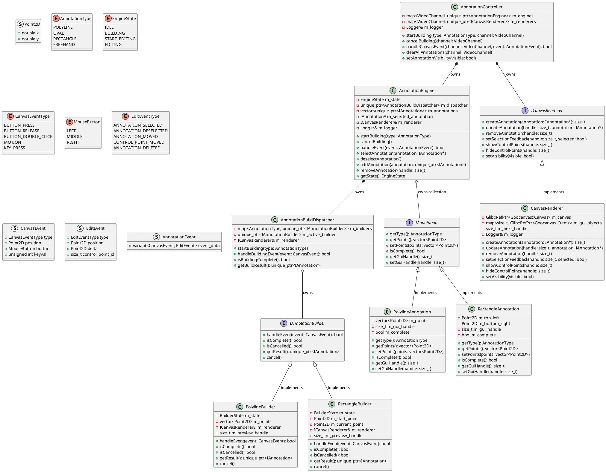

## Overview of functionality

This document describes the design and implementation of the annotation feature. The user can draw simple annotations on top of the video canvases to act as visual guides to measure, track, and illustrate positions and movements in the golf swing. We support:

- Polyline (straight line segments connected at the intersecting vertex)
- Oval (and the special case of a circle)
- Rectangle
- Freehand

The user initiates a build by clicking the appropriate GUI button for the desired annotation type. From there, GUI events are passed to an annotation builder which processes the events (mouse clicks, etc.) in a state machine to build the object. The user can also right click during the build of any annotation to cancel. During the build, we will illustrate the build in progress by rendering the annotation to reflect the progress. For example, when drawing a polyline, on the first left click we create a new line segment with one end anchored to the starting point, and the other tracking movements of the mouse. On the next left click, we fix the first line segment's second point to the current mouse location, and start a new line segment with its first point at the first line segment's end.

Additionally, once annotations are drawn, they can be selected and edited by the user. Editing is somewhat different for each type of annotation, but in general the annotation can be moved or edited by dragging control points. While selected, the user can also press delete to remove the selected annotation.

During annotation builds, we process the raw GUI events (click, mouse movement, etc.). During edits, we use the built-in event handling for the Goocanvas shape elements to implement the editing process.

## Event flow

### Building Process
1. User clicks GUI button for annotation type
2. `AnnotationController` receives event signal from canvas
3. `AnnotationController` passes event to `AnnotationEngine` to start the build
4. AnnotationEngine transitions to `BUILDING` state, activates appropriate builder
5. Raw canvas events (mouse clicks, movements, keys) flow: GUI → `AnnotationController` → `AnnotationEngine` → `AnnotationBuildDispatcher` → selected builder
5. Builder processes events, updates preview through `CanvasRenderer`, maintains internal state
6. On completion: builder creates final annotation object, `AnnotationEngine` adds to collection, creates persistent GUI representation
7. `AnnotationEngine` returns to IDLE state

### Editing Process
1. User clicks on existing annotation
2. GUI object (Goocanvas item) callback directly notifies `AnnotationController`
3. `AnnotationController` creates `EditEvent` (ANNOTATION_SELECTED) and sends to `AnnotationEngine`
4. `AnnotationEngine` processes `ANNOTATION_SELECTED` event, transitions to `START_EDITING`
5. `AnnotationEngine` triggers `CanvasRenderer` to show selection feedback and control points, and transitions to `EDITING` state
6. User drags annotation or control points triggering callbacks to `AnnotationController`
7. `AnnotationController` creates `EditEvent` (`ANNOTATION_MOVED`/`CONTROL_POINT_MOVED`) and sends to `AnnotationEngine`
8. `AnnotationEngine` processes `EditEvent`, updates logical annotation data and refreshes GUI
9. User clicks elsewhere to deselect annotation object - `AnnotationController` receives callback and sends `ANNOTATION_DESELECTED` event, `AnnotationEngine` returns to `IDLE` state. Note if the user selects another annotation, this will be processed through the `START_EDITING`/`EDITING` state transitions in `AnnotationEngine`, e.g. selection of another annotation object will hide control points and any other steps to finish editing on the original object, and then enter `START_EDITING` to set up the newly selected object for editing.

## Data model

<font color=red><b>NEEDS FURTHER DEFINITION</b></font>

Annotations have two parallel representations, one logical (representing the shape itself) and one physical (the actual GUI objects drawn on the canvas).

### Logical representation
Define type/struct/class for each one:
- Polyline is a collection of vertices
- Oval is the two center points and a radius(?)
- Rectangle is two vertices
- Freehand is an array of points

### GUI representation
Define the representation in terms of GUI objects:
- Polyline is a collection of straight lines
- Oval is an oval
- Rectangle is a rectangle
- Freehand is a collection of points?

## Class design overview

`AnnotationController`
- Pure GUI-to-business logic interface layer
- Manages one AnnotationEngine per canvas (left/right video channels)
- Routes GUI events and commands to appropriate engine
- Owns `CanvasRenderer` instances for GUI abstraction
- No business logic - just coordination and event forwarding

`AnnotationEngine`
- High-level state management and annotation lifecycle coordination for building and editing annotations
- Simple state machine: `IDLE`, `BUILDING`, `START_EDITING`, `EDITING`
- Owns the annotation collection as handles referencing GUI objects owned by CanvasRenderer
- Delegates building events by routing to `AnnotationBuildDispatcher`
- Processes editing events directly by triggering the appropriate `CanvasRenderer` calls for the selected/deselected objects
- Handles annotation completion and cleanup

`AnnotationBuildDispatcher`
- Event routing and builder management for building process only
- Owns all builders for different annotation types
- Routes events to active builder during building state
- Handles enabling/disabling annotation selection during building

`ICanvasRenderer`
- Abstract interface for all GUI operations triggered by the annotation system
- Provides handle-based references to GUI objects
- Methods for creating, updating, and managing annotation visuals
- Handles editing through direct callbacks that update annotation data
- Abstracts GTK/Goocanvas implementation from business logic

`CanvasRenderer`
- Concrete implementation of ICanvasRenderer
- Owns actual Goocanvas objects and manages their lifecycle
- Provides handle-based abstraction for business logic
- Creates control points with direct callbacks for editing
- Handles coordinate transformations and visual styling

`IAnnotationBuilder`
- Defines the interface for the individual annotation builders

`PolylineBuilder` \
`OvalBuilder` \
`RectangleBuilder` \
`FreehandBuilder`
- Implement the `IAnnotationBuilder` interface
- Process events forwarded from `AnnotationBuildDispatcher` to construct the annotation
- Run internal state machine to manage build
- Report when complete, and return the object (if one was created, e.g. the build was completed and not canceled)

## Detailed class design

<font color='red'><b>Need detailed review of class diagram and interfaces</b></font>

### Class diagram



### Interface specifications

#### Core Data Types (AnnotationTypes.h)
```cpp
#include <variant>
#include <vector>

struct Point2D
{
    double x;
    double y;
    
    Point2D() : x(0.0), y(0.0) {}
    Point2D(double x_val, double y_val) : x(x_val), y(y_val) {}
};

enum class AnnotationType
{
    POLYLINE,
    OVAL, 
    RECTANGLE,
    FREEHAND
};

enum class CanvasEventType
{
    BUTTON_PRESS,
    BUTTON_RELEASE,
    BUTTON_DOUBLE_CLICK,
    MOTION,
    KEY_PRESS
};

enum class MouseButton
{
    LEFT = 1,
    MIDDLE = 2,
    RIGHT = 3
};

enum class EditEventType
{
    ANNOTATION_SELECTED,
    ANNOTATION_DESELECTED,
    ANNOTATION_MOVED,
    CONTROL_POINT_MOVED,
    ANNOTATION_DELETED
};

struct CanvasEvent
{
    CanvasEventType type;
    Point2D position;
    MouseButton button;
    unsigned int keyval;
    
    CanvasEvent(CanvasEventType t, Point2D pos, MouseButton btn = MouseButton::LEFT, unsigned int key = 0)
        : type(t), position(pos), button(btn), keyval(key) {}
};

struct EditEvent
{
    EditEventType type;
    Point2D position;
    Point2D delta;
    size_t control_point_id;
    
    EditEvent(EditEventType t, Point2D pos = Point2D(), Point2D d = Point2D(), size_t cp_id = 0)
        : type(t), position(pos), delta(d), control_point_id(cp_id) {}
};

struct AnnotationEvent
{
    std::variant<CanvasEvent, EditEvent> event_data;
    
    // Convenience constructors
    AnnotationEvent(const CanvasEvent& canvas_event) : event_data(canvas_event) {}
    AnnotationEvent(const EditEvent& edit_event) : event_data(edit_event) {}
    
    // Type checking helpers
    bool isCanvasEvent() const { return std::holds_alternative<CanvasEvent>(event_data); }
    bool isEditEvent() const { return std::holds_alternative<EditEvent>(event_data); }
    
    // Accessors
    const CanvasEvent& getCanvasEvent() const { return std::get<CanvasEvent>(event_data); }
    const EditEvent& getEditEvent() const { return std::get<EditEvent>(event_data); }
};

using AnnotationHandle = size_t;
const AnnotationHandle INVALID_ANNOTATION_HANDLE = 0;
```

#### AnnotationController Interface
```cpp
class AnnotationController
{
public:
    // GUI command interface
    void startBuilding(AnnotationType annotation_type, VideoPlayback::WhichVideoChannel channel);
    void cancelBuilding(VideoPlayback::WhichVideoChannel channel);
    
    // Event handling from GUI
    bool handleCanvasEvent(VideoPlayback::WhichVideoChannel channel, const AnnotationEvent& event);
    
    // Annotation management
    void clearAllAnnotations(VideoPlayback::WhichVideoChannel channel);
    void setAnnotationVisibility(bool visible);
    
    // State queries
    bool isBuilding(VideoPlayback::WhichVideoChannel channel) const;
    bool isEditing(VideoPlayback::WhichVideoChannel channel) const;
};
```

#### ICanvasRenderer Interface
```cpp
class ICanvasRenderer
{
public:
    virtual ~ICanvasRenderer() = default;
    
    // Annotation GUI object lifecycle
    virtual AnnotationHandle createAnnotation(IAnnotation* annotation) = 0;
    virtual void updateAnnotation(AnnotationHandle handle, IAnnotation* annotation) = 0;
    virtual void removeAnnotation(AnnotationHandle handle) = 0;
    
    // Visual feedback for editing
    virtual void setSelectionFeedback(AnnotationHandle handle, bool selected) = 0;
    virtual void showControlPoints(AnnotationHandle handle) = 0;
    virtual void hideControlPoints(AnnotationHandle handle) = 0;
    
    // Global visibility control
    virtual void setVisibility(bool visible) = 0;
};
```

#### IAnnotationBuilder Interface
```cpp
class IAnnotationBuilder
{
public:
    virtual ~IAnnotationBuilder() = default;
    
    // Event processing during build
    virtual bool handleEvent(const CanvasEvent& event) = 0;
    
    // State queries
    virtual bool isComplete() const = 0;
    virtual bool isCancelled() const = 0;
    
    // Result retrieval
    virtual std::unique_ptr<IAnnotation> getResult() = 0;
    
    // Cancellation
    virtual void cancel() = 0;
};
```

#### IAnnotation Interface
```cpp
class IAnnotation
{
public:
    virtual ~IAnnotation() = default;
    
    // Type identification
    virtual AnnotationType getType() const = 0;
    
    // Data access
    virtual std::vector<Point2D> getPoints() const = 0;
    virtual void setPoints(const std::vector<Point2D>& points) = 0;
    
    // State
    virtual bool isComplete() const = 0;
    virtual void setComplete(bool complete) = 0;
    
    // GUI handle management
    virtual AnnotationHandle getGuiHandle() const = 0;
    virtual void setGuiHandle(AnnotationHandle handle) = 0;
};
```

## Event handling

How to receive events from the Gtk event loop and forward to `AnnotationManager`?

Sequence diagrams for building and editing


## Implementation notes

### Enable canvas events for building

```
void AnalyzerGui::setUpGui()
{
    // ... existing canvas setup ...
    
    // Enable events for annotation interaction
    m_canvas_left->set_events(Gdk::BUTTON_PRESS_MASK | 
                             Gdk::BUTTON_RELEASE_MASK | 
                             Gdk::POINTER_MOTION_MASK |
                             Gdk::KEY_PRESS_MASK);
    m_canvas_right->set_events(Gdk::BUTTON_PRESS_MASK | 
                              Gdk::BUTTON_RELEASE_MASK | 
                              Gdk::POINTER_MOTION_MASK |
                              Gdk::KEY_PRESS_MASK);
}
```

### Features for editing
```
// Each annotation item can handle its own events
auto polyline_item = Goocanvas::Polyline::create(points);
polyline_item->signal_button_press_event().connect(
    sigc::bind(sigc::mem_fun(*this, &AnnotationEditor::onItemSelected), 
               annotation_id));
polyline_item->signal_motion_notify_event().connect(
    sigc::bind(sigc::mem_fun(*this, &AnnotationEditor::onItemDrag), 
               annotation_id));

// Modify item properties to show selection state
class AnnotationEditor
{
private:
    Glib::RefPtr<Goocanvas::Item> m_selected_item;
    
public:
    void selectAnnotation(Glib::RefPtr<Goocanvas::Item> item)
    {
        // Deselect previous
        if (m_selected_item)
        {
            m_selected_item->property_stroke_color() = m_original_color;
            m_selected_item->property_line_width() = m_original_width;
        }
        
        // Select new
        m_selected_item = item;
        if (m_selected_item)
        {
            m_selected_item->property_stroke_color() = "blue";
            m_selected_item->property_line_width() = m_original_width + 2;
        }
    }
};

// Create control points for editing
class PolylineEditor : public IAnnotationEditor
{
private:
    std::vector<Glib::RefPtr<Goocanvas::Ellipse>> m_control_points;
    Glib::RefPtr<Goocanvas::Polyline> m_polyline;
    
public:
    void showControlPoints()
    {
        m_control_points.clear();
        
        for (size_t i = 0; i < m_polyline_data.points.size(); ++i)
        {
            auto control_point = Goocanvas::Ellipse::create(
                m_polyline_data.points[i].x - 3, 
                m_polyline_data.points[i].y - 3, 
                6, 6);
            control_point->property_fill_color() = "blue";
            control_point->property_stroke_color() = "darkblue";
            
            // Connect drag events for this specific control point
            control_point->signal_motion_notify_event().connect(
                sigc::bind(sigc::mem_fun(*this, &PolylineEditor::onControlPointDrag), i));
                
            m_canvas->get_root_item()->add_child(control_point);
            m_control_points.push_back(control_point);
        }
    }
    
    bool onControlPointDrag(GdkEventMotion* event, size_t point_index)
    {
        // Update the polyline point
        m_polyline_data.points[point_index].x = event->x;
        m_polyline_data.points[point_index].y = event->y;
        
        // Rebuild the polyline with new points
        updatePolylineDisplay();
        return true;
    }
};

// temporarily disconnect the selection events on existing annotations while building
void AnnotationEngine::startBuilding(AnnotationType annotation_type)
{
    if (m_state == AnnotationEngineState::EDITING)
    {
        stopEditing();
    }
    
    auto builder_it = m_builders.find(annotation_type);
    if (builder_it == m_builders.end())
    {
        m_logger.error("No builder available for annotation type: %d", static_cast<int>(annotation_type));
        return;
    }
    
    m_active_builder = std::move(builder_it->second);
    
    // Disable selection of existing annotations during building
    disableAnnotationSelection();
    
    transitionToState(AnnotationEngineState::BUILDING);
    m_logger.debug("Started building annotation of type: %d", static_cast<int>(annotation_type));
}

void AnnotationEngine::disableAnnotationSelection()
{
    m_logger.debug("Disabling annotation selection during building");
    
    for (auto& connection_group : m_annotation_connections)
    {
        for (auto& connection : connection_group)
        {
            connection.block();
        }
    }
}

void AnnotationEngine::enableAnnotationSelection()
{
    m_logger.debug("Enabling annotation selection");
    
    for (auto& connection_group : m_annotation_connections)
    {
        for (auto& connection : connection_group)
        {
            connection.unblock();
        }
    }
}

```

