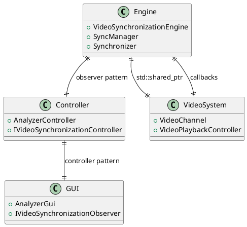
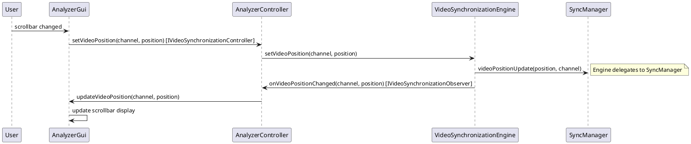
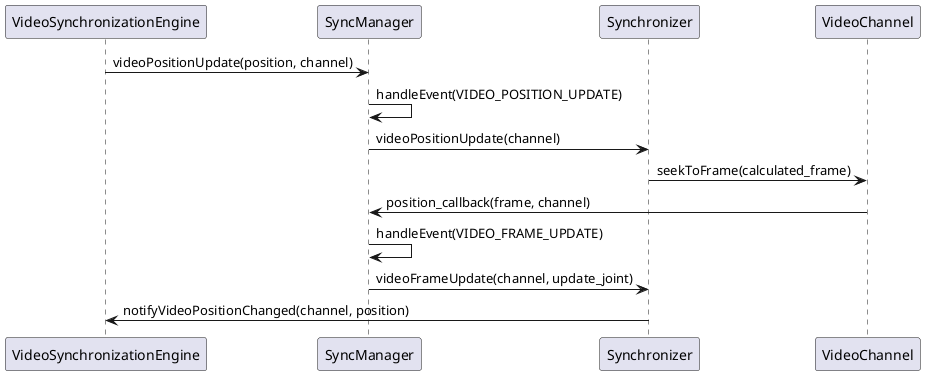
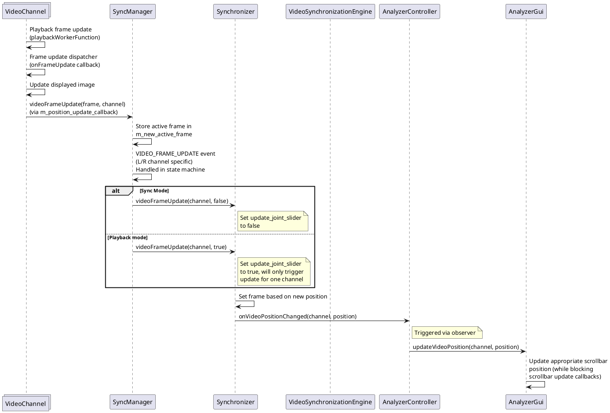
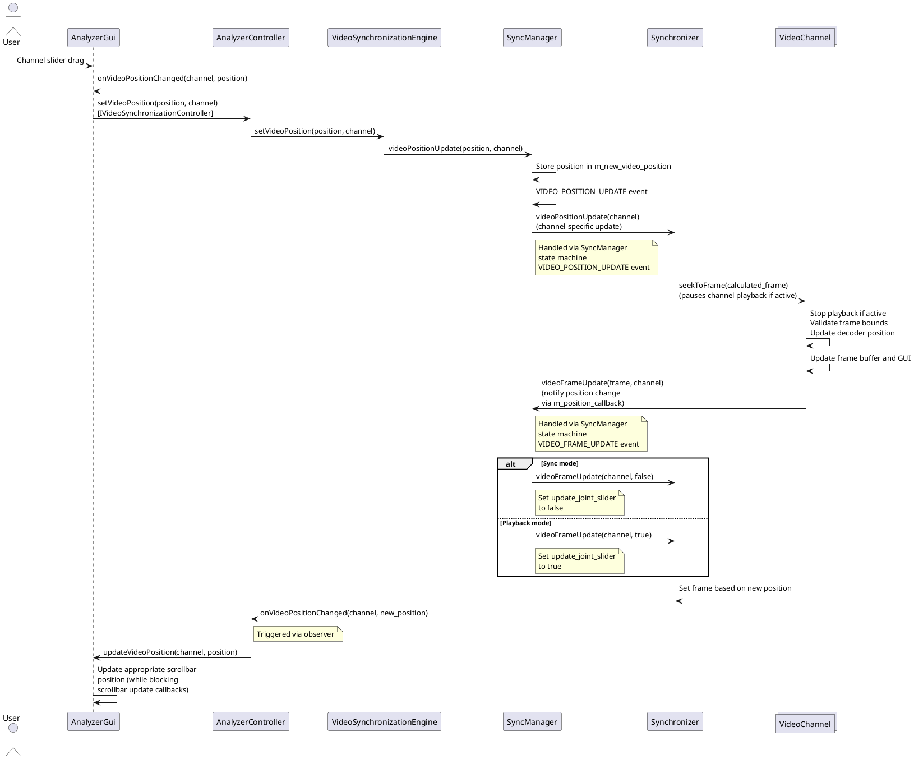
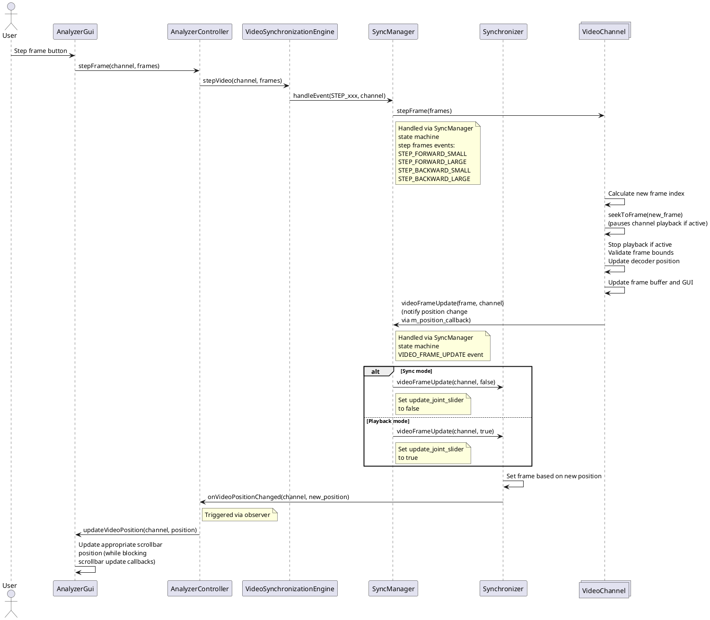

# Scroll bar synchronization

## Purpose

This document describes the implementation of the scroll bar synchronization feature between video channels in the SwingAnalyzer application.

## Architecture Overview

The scroll bar synchronization system uses a layered architecture with observer pattern and clean separation of concerns:



### Core Components

1. **VideoSynchronizationEngine**: Core synchronization engine managing video operations between system submodules
2. **AnalyzerController**: Mediates between engine and GUI, implements both controller and observer interfaces
3. **AnalyzerGui**: Pure GUI component handling user interactions and display updates
4. **SyncManager**: Orchestrates synchronization using internal state machine pattern
5. **Synchronization State Machine**: Implements different synchronizer operational modes (sync, playback)
6. **VideoChannel**: Manages individual video playback channel with shared pointer ownership


## Architecture Pattern

### Observer Pattern Implementation
The system uses the observer pattern for GUI updates:

```cpp
// Observer interface for GUI updates
class IVideoSynchronizationObserver {
    virtual void onVideoPositionChanged(WhichVideoChannel channel, float position) = 0;
    virtual void onPlaybackStateChanged(WhichVideoChannel channel, VideoPlaybackStatus status) = 0;
    virtual void onSyncModeChanged(bool syncMode) = 0;
    // ...
};
```

### Controller Pattern Implementation
User actions are handled through a controller interface:

```cpp
// Controller interface for user actions
class IVideoSynchronizationController {
    virtual void playVideo(WhichVideoChannel channel) = 0;
    virtual void setVideoPosition(WhichVideoChannel channel, float position) = 0;
    // ...
};
```

## Component Interaction Flow

### Primary Architecture Flow


### Internal Flow (SyncManager Components)
The VideoSynchronizationEngine delegates to the existing SyncManager for actual synchronization logic:



### Scroll Bar Drag vs Button Press Differentiation
The key to preventing infinite loops is the connection blocking mechanism:

```cpp
// In AnalyzerGui::updateVideoPosition()
void AnalyzerGui::updateVideoPosition(WhichVideoChannel channel, float position) {
    switch (channel) {
        case LEFT_CHANNEL:
            // Block the signal connection to prevent recursion
            m_left_channel_scrollbar_connection.block();
            m_guiObjects.scrollVideoLeft->set_value(position);
            m_left_channel_scrollbar_connection.unblock();
            break;
        // ...
    }
}

// In AnalyzerGui::connectSignals()
m_left_channel_scrollbar_connection = m_guiObjects.scrollVideoLeft->signal_value_changed().connect([this]() {
    // This callback is blocked during programmatic updates
    this->onVideoPositionChanged(LEFT_CHANNEL, this->m_guiObjects.scrollVideoLeft->get_value());
});
```

## Sequence Diagrams

### Video playback frame update triggers scrollbar update



### User drags channel scrollbar

Here, the scrollbar triggers the update of the video frame in one (sync mode) or both (playback mode) channels. The video channel triggers the callbacks and observer to update the slider. Since the slider update is conducted in a blocking mode, we don't get an infinite loop here. That is, the user moving the slider will trigger the slider getting adjusted because of the frame update, but because the latter slider update does not trigger a frame update we do not get an infinite loop.



### User steps frame


