## Sync mode

### User drags channel scrollbar

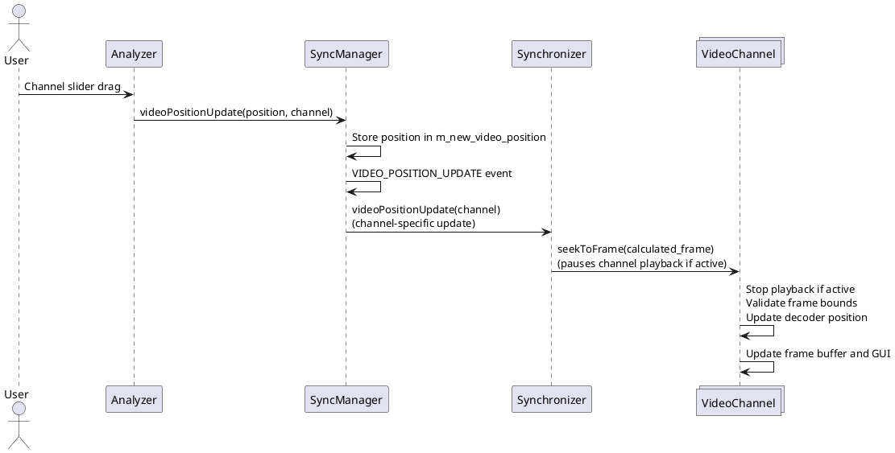

### Video frame update triggers scrollbar update

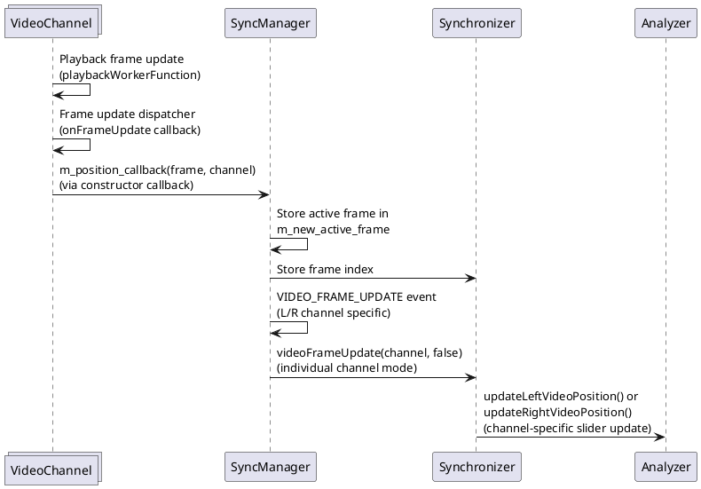

## Playback mode

### User drags joint scrollbar

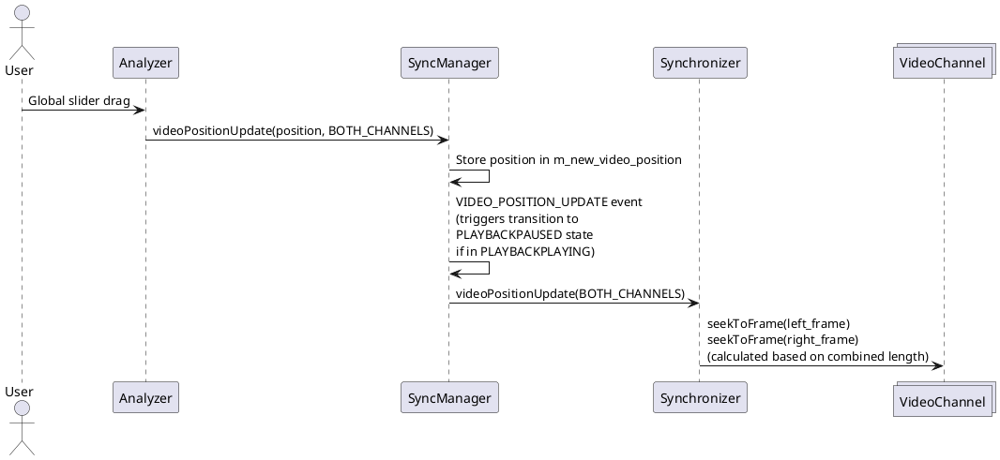

### Update joint scrollbar during playback

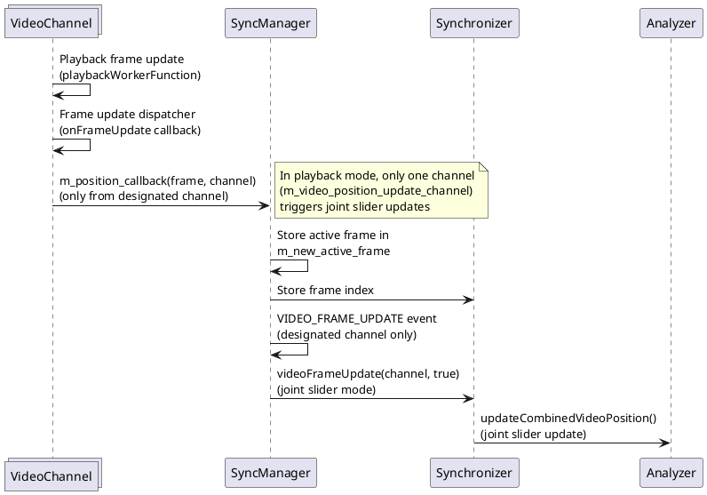

## Implementation Details

### VideoChannel Callback Architecture

The VideoChannel implements position callbacks through a constructor parameter:
```cpp
VideoChannel(WhichVideoChannel channel, 
            std::function<void(int, WhichVideoChannel)> update_callback)
```

The callback (`m_position_callback`) is triggered in two key locations:
1. **seekToFrame()** - When externally seeking to a specific frame (slider drag, stepping)
2. **onFrameUpdate()** - During internal playback via the frame update dispatcher

### Position Update Flow

**External Updates (Slider/Step):**
- `Analyzer` → `SyncManager::videoPositionUpdate()` → `Synchronizer::videoPositionUpdate()` → `VideoChannel::seekToFrame()`
- `seekToFrame()` triggers `m_position_callback()` to update the slider position

**Internal Updates (Playback):**
- `playbackWorkerFunction()` → `m_frame_update_dispatcher.emit()` → `onFrameUpdate()` → `m_position_callback()`
- The callback flows to `SyncManager::videoFrameUpdate()` → state machine → `Synchronizer::videoFrameUpdate()`

### State-Dependent Behavior

**Sync Mode:**
- Each channel independently updates its own slider via `updateLeftVideoPosition()` or `updateRightVideoPosition()`
- Both channels can trigger position updates independently

**Playback Mode:**
- Only the designated channel (`m_video_position_update_channel`) updates the joint slider
- The channel selection is determined during sync-to-playback transition based on which video is shorter
- Joint slider updates use `updateCombinedVideoPosition()`

### Thread Safety

The VideoChannel uses thread-safe mechanisms:
- `Glib::Dispatcher` for cross-thread communication from playback worker to main thread
- `ThreadSafeFrameBuffer` for frame data sharing between threads
- Position callbacks are invoked from the main thread context

## Error Handling Scenarios

### Input Validation Errors

The system includes comprehensive input validation with appropriate error responses:

#### Invalid Slider Position
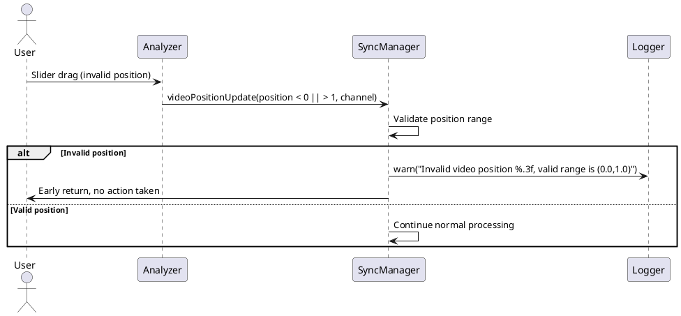

#### Invalid Frame Index
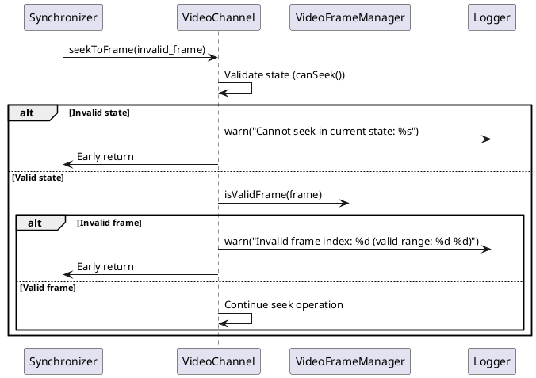

#### Invalid Video Size
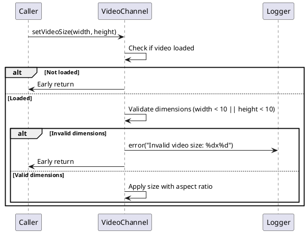

### State Machine Validation Errors

#### Invalid State Transitions
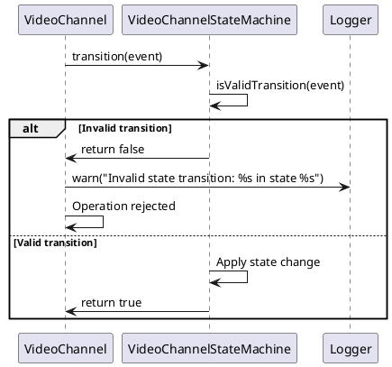

#### Playback State Conflicts
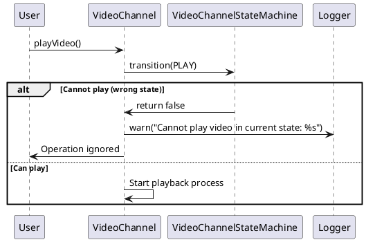

### Frame Management Errors

#### Frame Range Validation
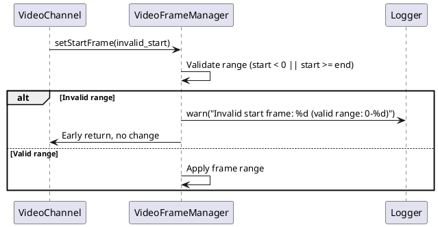

#### Frame Step Bounds Checking
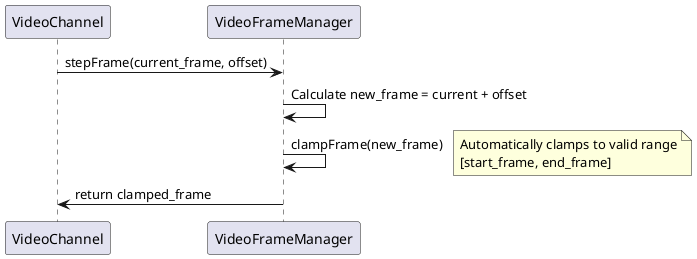

### Thread Safety and Resource Errors

#### Empty Frame Handling
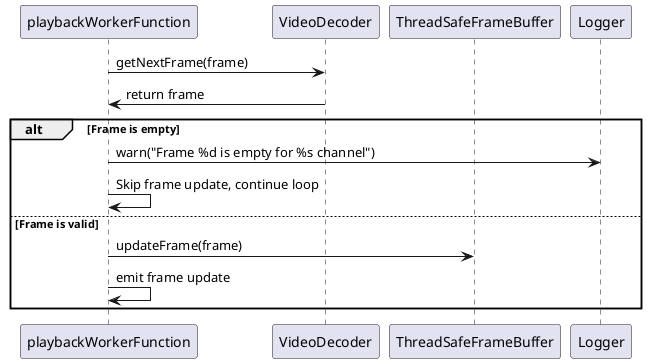

#### Buffer Validation
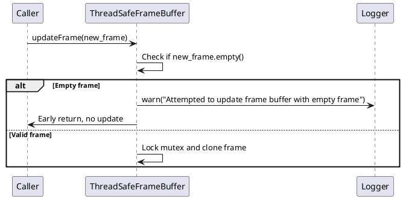

### Decoder and File System Errors

#### Video Load Failure
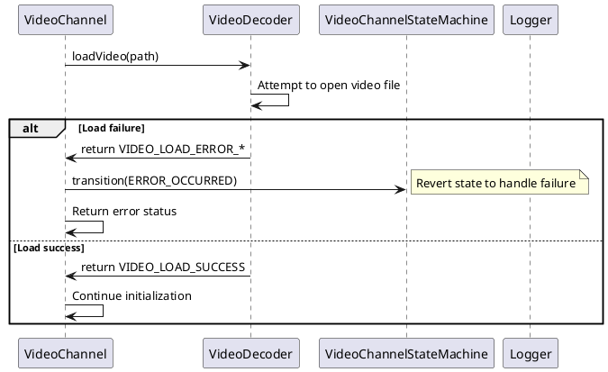

#### Frame Seek Failure
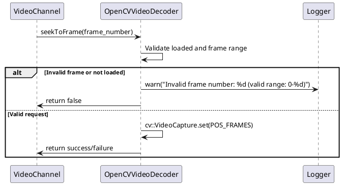

### Configuration Validation Errors

#### Framerate Multiplier Validation
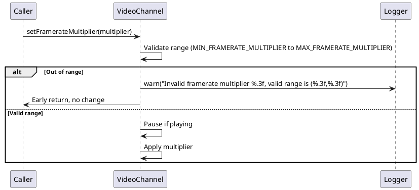

#### Synchronizer Channel Validation
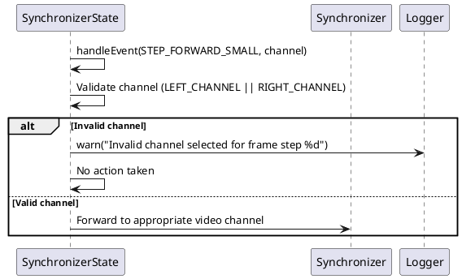
