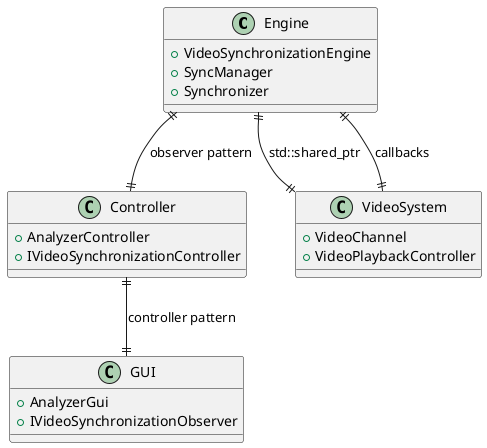

# SwingAnalyzer System Architecture

## Document Overview

This document describes the complete system architecture of the SwingAnalyzer application, including the class hierarchy, component relationships, and design patterns used.

Additional design documentation is available:
- <a href="Video synchronization and playback.md">Video syncronization and playback</a>
- <a href="Video channel frame update.md">Video channel frame updates</a>
- <a href="Scroll bar synchronization.md">Scroll bar synchronization</a>

## System Overview

SwingAnalyzer is a desktop application for frame-accurate, side-by-side comparison of two golf swing videos. It provides precise synchronization, independent and joint playback controls, and responsive visual feedback to support coaching, analysis, and self-review workflows.

Functionality
- Load and manage two independent video channels (left/right)
- SYNC mode for aligning swings via per-channel play/pause/step/seek
- PLAYBACK mode for synchronized joint playback with shared controls
- Frame offset calculation and framerate ratio handling
- Variable playback rate and single/multi-frame stepping
- Scrollbar updates and position callbacks for real-time GUI feedback
- Threaded playback to maintain smooth rendering and UI responsiveness

Use cases
- Coach–athlete review: align and compare two swings from different sessions
- Before/after comparison: evaluate changes from drills or equipment adjustments
- Reference vs. current: compare against a model swing or previous best
- Club/lie/ball position experiments: assess impact across variations

Requirements
- Functional
    - Load videos per channel and report load status
    - Independent channel control in SYNC; shared control in PLAYBACK
    - Frame-accurate seek, step, and synchronized position updates
    - Observer-driven GUI updates for position and playback state
    - User-selectable playback rate and toggle between modes
- Non-functional
    - Smooth playback for typical HD footage using threaded timing control
    - Deterministic state transitions via explicit state machines
    - Pluggable video backends and GUI updaters (OpenCV decoder, GTK/Goocanvas)
    - Safe concurrency for frame buffers and playback control
    - Clear separation of concerns (GUI, controller, engine, video components)

## Architecture Overview

The scroll bar synchronization system uses a layered architecture. Primary submodules include:

1. **Video Synchronization Engine**: Core synchronization engine managing video operations between system submodules 
2. **Video System**: Video management and playback for a single video channel
3. **Controller**: Mediates between engine and GUI, implements both controller and observer interfaces
4. **GUI**: GUI component handling user interactions and display updates



## Layer Hierarchy

This section presents the major hierarchical layers of the software and introduces key classes.

### GUI Layer (Presentation)
- **AnalyzerWindow**: Top-level GTK window managing the overall application
    - Manages application lifecycle and window events
    - Coordinates controller and GUI components
- **AnalyzerGui**: Pure GUI management focused on user interface components and GTK/Goocanvas integration. Abstracts the GTK implementation of the GUI for the controller layer of the software.
    - Handles GTK widget management and user interactions
    - Manages video canvas setup and control signal connections

### Controller Layer (Mediation)
- **AnalyzerController**: Mediates between GUI and business logic using Controller and Observer patterns
    - Implements both controller and observer interfaces for clean mediation
    - Bridges GUI events to business logic using dependency injection
    - Implements `IVideoSynchronizationController` interface for high-level video system commands
    - Implements `IVideoSynchronizationObserver` interface for handling video playback notifications
- **VideoSynchronizationEngine** (Business logic orchestrator)
    - Coordinates all video synchronization operations
    - Manages observer notifications and video channel access
    - Registers the `AnalyzerController` as an observer, and then forwards that observer on to the `SyncManager` (and thus also `Synchronizer`)

### Business Logic Layer (Core Domain)
- **VideoSynchronizationEngine**: Main orchestrator coordinating video synchronization operations
- **SyncManager**: State machine manager controlling sync and playback modes
    - Owns video channels and manages synchronization state machine
    - Routes events through current state handlers
    - State machine classes implement `ISynchronizerState` interface
        - Base for all synchronization states 
        - Provides clean and consisteng state transition mechanism
    - Concrete State Classes:
        - `SynchronizerStateSync`: Independent video channel control mode
        - `SynchronizerStateSyncToPlayback`: Transition state for offset calculation
        - `SynchronizerStatePlaybackPaused`: Synchronized playback when paused
        - `SynchronizerStatePlaybackPlaying`: Synchronized playback when playing
- **Synchronizer**: Core synchronization logic managing coordination between the two video channels
    - Implements `ISynchronizerActions` interface to decouple from state machine
    - Calculates frame offsets and manages synchronized playback parameters
    - Handles framerate differences and position updates

### Video Components Layer (Infrastructure)
- **VideoChannel**: Modular video player managing a single playback channel
    - Pluggable architecture with interface-based components
    - Handles individual video playback with state machine management
- **Video Support Components**: Specialized classes for decoding, GUI updates, frame management, and playback control
    - `VideoChannelStateMachine`: State management for video channel lifecycle
    - `IVideoDecoder/OpenCVVideoDecoder`: Video file loading and frame extraction
    - `IGUIImageUpdater/GTKImageUpdater`: GUI display updates
    - `VideoFrameManager`: Frame range validation and navigation
    - `VideoPlaybackController`: Threaded playback timing control
    - `ThreadSafeFrameBuffer`: Thread-safe frame data management

## Class Diagram

```plantuml
@startuml

package "GUI Layer" #LightBlue {
    class AnalyzerWindow {
        +AnalyzerWindow(BaseObjectType, Builder, videoPath)
        -m_builder: Glib::RefPtr<Gtk::Builder>
        -m_pController: shared_ptr<AnalyzerController>
        -m_pGui: unique_ptr<AnalyzerGui>
        -m_windowWidth: int
        -m_windowHeight: int
    }

    class AnalyzerGui {
        +AnalyzerGui(Builder, Controller)
        +loadGuiObjects(): void
        +setUpGui(): void
        +connectSignals(): void
        +updateVideoPosition(): void
        +syncModeToggle(): void
        +setVideoRenderer(): void
        -m_builder: Glib::RefPtr<Gtk::Builder>
        -m_controller: IVideoSynchronizationController*
        -m_guiObjects: AnalyzerGuiObjects
        -m_canvas_left: Goocanvas::Canvas*
        -m_canvas_right: Goocanvas::Canvas*
    }

    struct AnalyzerGuiObjects {
        +btnPlay: Gtk::Button*
        +btnLoadLeftVideo: Gtk::Button*
        +btnLoadRightVideo: Gtk::Button*
        +scrollVideoLeft: Gtk::Scrollbar*
        +scrollVideoRight: Gtk::Scrollbar*
        +scrollVideo: Gtk::Scrollbar*
        +chkSyncMode: Gtk::CheckButton*
        +comboPlaybackRate: Gtk::ComboBoxText*
        ...
    }
}

package "Controller Layer" #LightGreen {
    interface IVideoSynchronizationController {
        +playVideo(channel): void
        +pauseVideo(channel): void
        +stepVideo(channel, frames): void
        +setVideoPosition(channel, position): void
        +loadVideo(channel, path): void
        +setSyncMode(enabled): void
        +setPlaybackRate(multiplier): void
    }

    interface IVideoSynchronizationObserver {
        +onVideoPositionChanged(channel, position): void
        +onPlaybackStateChanged(channel, status): void
        +onSyncModeChanged(syncMode): void
        +onVideoLoaded(channel, success): void
        +onVideoUnloaded(channel): void
    }

    class AnalyzerController {
        +AnalyzerController(gui): AnalyzerController
        +initialize(): void
        +getVideoChannel(channel): VideoChannel*
        -m_gui: AnalyzerGui*
        -m_engine: shared_ptr<VideoSynchronizationEngine>
    }
}

package "Business Logic Layer" #LightYellow {
    class VideoSynchronizationEngine {
        +VideoSynchronizationEngine()
        +addObserver(observer): void
        +playVideo(channel): void
        +loadVideo(channel, path): void
        +setSyncMode(enabled): void
        +start(): void
        +getVideoChannel(channel): VideoChannel*
        -m_syncManager: unique_ptr<SyncManager>
        -m_observers: vector<weak_ptr<IVideoSynchronizationObserver>>
    }

    class SyncManager {
        +SyncManager()
        +handleEvent(event, channel): void
        +setObserver(observer): void
        +start(): void
        +videoPositionUpdate(position, channel): void
        +getLeftChannel(): VideoChannel*
        +getRightChannel(): VideoChannel*
        -m_channel_left: shared_ptr<VideoChannel>
        -m_channel_right: shared_ptr<VideoChannel>
        -m_synchronizer: Synchronizer
        -m_state: unique_ptr<ISynchronizerState>
        -m_observer: weak_ptr<IVideoSynchronizationObserver>
    }

    class Synchronizer {
        +Synchronizer(channel_left, channel_right)
        +setObserver(observer): void
        +calculateFramerateRatio(): void
        +stepVideos(step_size): void
        +videoPositionUpdate(channel): void
        +videoFrameUpdate(channel, update_joint_slider): void
        -m_pChannel_left: shared_ptr<VideoChannel>
        -m_pChannel_right: shared_ptr<VideoChannel>
        -m_video_frame_offset: int
        -m_framerate_ratio: float
        -m_combined_length: int
        -m_observer: weak_ptr<IVideoSynchronizationObserver>
    }
}

package "State Machine" #LightCyan {
    interface ISynchronizerActions {
        +playVideos(): void
        +pauseVideos(): void
        +setVideosToStartPosition(): void
        +stepVideos(step_size): void
        +playVideo(channel): void
        +pauseVideo(channel): void
        +stepVideo(channel, step_size): void
        +getVideoPlaybackStatus(channel): VideoPlaybackStatus
        +setupVideoSync(): void
        +calculateFramerateRatio(): void
        +clearStartAndEndFrames(): void
        +setVideoFrameOffset(offset): void
        +videoPositionUpdate(channel): void
        +videoFrameUpdate(channel, update_joint_slider): void
        +getVideoPositionUpdateChannel(): WhichVideoChannel
        +getNewVideoPosition(): float
        +setNewVideoPosition(position): void
        +getVideoFrameOffset(): int
    }

    interface ISynchronizerState {
        +handleEvent(event, channel): unique_ptr<ISynchronizerState>
        +getName(): string&
        #m_pSynchronizer: ISynchronizerActions*
        #m_name: string
    }

    class SynchronizerStateSync {
        +SynchronizerStateSync(synchronizer)
        +handleEvent(event, channel): unique_ptr<ISynchronizerState>
    }

    class SynchronizerStateSyncToPlayback {
        +SynchronizerStateSyncToPlayback(synchronizer)
        +handleEvent(event, channel): unique_ptr<ISynchronizerState>
    }

    class SynchronizerStatePlaybackPaused {
        +SynchronizerStatePlaybackPaused(synchronizer)
        +handleEvent(event, channel): unique_ptr<ISynchronizerState>
    }

    class SynchronizerStatePlaybackPlaying {
        +SynchronizerStatePlaybackPlaying(synchronizer)
        +handleEvent(event, channel): unique_ptr<ISynchronizerState>
    }
}

package "Video Components" #LightPink {
    class VideoChannel {
        +VideoChannel(channel, callback)
        +loadVideo(path): VideoLoadStatus
        +playVideo(): bool
        +pauseVideo(): bool
        +stepFrame(frames): void
        +seekToFrame(frame): void
        +getActiveFrame(): int
        +getVideoSize(): VideoSize
        +setVideoSize(width, height): void
        +getImage(): Glib::RefPtr<Goocanvas::Image>&
        -m_state_machine: unique_ptr<VideoChannelStateMachine>
        -m_video_decoder: unique_ptr<IVideoDecoder>
        -m_gui_updater: unique_ptr<IGUIImageUpdater>
        -m_frame_manager: unique_ptr<VideoFrameManager>
        -m_playback_controller: unique_ptr<VideoPlaybackController>
        -m_frame_buffer: unique_ptr<ThreadSafeFrameBuffer>
        -m_channel_id: WhichVideoChannel
        -m_position_callback: function<void(int, WhichVideoChannel)>
    }

    class VideoChannelStateMachine {
        +transitionTo(event): bool
        +getCurrentState(): VideoChannelState
        +getStateName(): string
        -m_current_state: VideoChannelState
    }

    interface IVideoDecoder {
        +loadVideo(path): VideoLoadStatus
        +seekToFrame(frame): bool
        +getCurrentFrame(): cv::Mat
        +isLoaded(): bool
        +getFrameCount(): int
        +getFramerate(): float
    }

    class OpenCVVideoDecoder {
        +loadVideo(path): VideoLoadStatus
        +seekToFrame(frame): bool
        +getCurrentFrame(): cv::Mat
        -m_video_capture: cv::VideoCapture
        -m_frame_count: int
        -m_framerate: float
    }

    interface IGUIImageUpdater {
        +setImageSize(width, height): void
        +updateImage(frame): void
        +getImage(): void*
    }

    class GTKImageUpdater {
        +setImageSize(width, height): void
        +updateImage(frame): void
        +getImage(): void*
        -m_goo_image: Glib::RefPtr<Goocanvas::Image>
        -m_pixbuf: Glib::RefPtr<Gdk::Pixbuf>
    }

    class VideoFrameManager {
        +setTotalFrames(count): void
        +setFrameRange(start, end): void
        +isValidFrame(frame): bool
        +clampFrame(frame): int
        +getStartFrame(): int
        +getEndFrame(): int
        -m_start_frame: int
        -m_end_frame: int
        -m_total_frames: int
    }

    class VideoPlaybackController {
        +startPlayback(framerate): void
        +stopPlayback(): void
        +setFramerate(fps): void
        +isPlaying(): bool
        -m_target_framerate: float
        -m_is_playing: bool
        -m_playback_thread: thread
    }

    class ThreadSafeFrameBuffer {
        +updateFrame(frame): void
        +getDisplayFrame(width, height): cv::Mat
        +hasFrame(): bool
        -m_current_frame: cv::Mat
        -m_frame_mutex: mutex
    }
}

' Relationships
AnalyzerWindow *-- AnalyzerGui
AnalyzerWindow o-- AnalyzerController
AnalyzerGui --> IVideoSynchronizationController
AnalyzerController ..|> IVideoSynchronizationController
AnalyzerController ..|> IVideoSynchronizationObserver
AnalyzerController o-- VideoSynchronizationEngine
VideoSynchronizationEngine *-- SyncManager
SyncManager *-- Synchronizer
SyncManager o-- ISynchronizerState
Synchronizer ..|> ISynchronizerActions
ISynchronizerState --> ISynchronizerActions
ISynchronizerState <|.. SynchronizerStateSync
ISynchronizerState <|.. SynchronizerStateSyncToPlayback
ISynchronizerState <|.. SynchronizerStatePlaybackPaused
ISynchronizerState <|.. SynchronizerStatePlaybackPlaying
SyncManager o-- VideoChannel
Synchronizer --> VideoChannel
VideoChannel *-- VideoChannelStateMachine
VideoChannel *-- IVideoDecoder
VideoChannel *-- IGUIImageUpdater
VideoChannel *-- VideoFrameManager
VideoChannel *-- VideoPlaybackController
VideoChannel *-- ThreadSafeFrameBuffer
IVideoDecoder <|-- OpenCVVideoDecoder
IGUIImageUpdater <|-- GTKImageUpdater

@enduml
```



## Implementation Details

### GUI Callbacks and Event Handling

*To be filled out*

### Video Synchronization and Playback

The video synchronization system exists in one of two high level modes, which then break down into several states implemented in the synchronizer state machine. The modes are `SYNC` and `PLAYBACK`. In `SYNC` mode, the user can adjust the two video channels independently (e.g. play, step, or drag the scrollbar to advance the displayed frame) to align events for synchronized playback. In `PLAYBACK` mode, there is one shared set of controls that manages playback and frame stepping for the combined channels once synchronized.

The synchronizer components (`Synchronizer`, `SyncManager`, and the synchronizer state machine state objects) handle commands coming from the controller, and pass video callbacks to the controller.

This is covered in depth in <a href="Video synchronization and playback.md">Video syncronization and playback</a> and <a href="Video channel frame update.md">Video channel frame updates</a>.

### Video Channel State Machine

The video channel itself implements a state machine to manage its internal states. The possible states are `UNLOADED` (no video loaded), `STOPPED` (video loaded but not playing), and `PLAYING` (video loaded and actively playing). For handling state transitions, the state machine class implementation checks on allowed transitions only (e.g. is the transition from state A to state B allowed). If there are events that gate the transition, for example successful loading of a video, checks are required in the `VideoChannel` object itself that the transition events succeed before executing the transition in the state machine.

### Observer Management for Playback Events

We use the observer pattern to communicate playback events (frame updates, playback complete, etc.) from the video layer to the controller layer. Observers implement the `IVideoSynchronizationObserver` interface. The `AnalyzerController` class is the only observer. The `AnalyzerController` owns the `VideoSynchronizationEngine`, and registers itself as an observer with the `VideoSynchronizationEngine` object. The `VideoSynchronizationEngine` then passes on that registration to the `SyncManager`, which passes it on to the `Synchronizer`. The `Synchronizer` and `SyncManager` (and associated state objects) then propagate relevant events to the `AnalyzerController` observer. Events are propagated from the `VideoChannels` to the `Synchronizer` and `SyncManager` via callbacks.

## Architectural Patterns

### Observer Pattern Implementation
The system uses the observer pattern for GUI updates:

```cpp
// Observer interface for GUI updates
class IVideoSynchronizationObserver {
    virtual void onVideoPositionChanged(WhichVideoChannel channel, float position) = 0;
    virtual void onPlaybackStateChanged(WhichVideoChannel channel, VideoPlaybackStatus status) = 0;
    virtual void onSyncModeChanged(bool syncMode) = 0;
    // ...
};
```

### Controller Pattern Implementation
User actions are handled through a controller interface:

```cpp
// Controller interface for user actions
class IVideoSynchronizationController {
    virtual void playVideo(WhichVideoChannel channel) = 0;
    virtual void setVideoPosition(WhichVideoChannel channel, float position) = 0;
    // ...
};
```

### State Machine Pattern
- Clean management of synchronization modes (sync vs. playback)
- Event-driven transitions with state-specific behavior

### Dependency Injection
- GUI receives controller interface, not concrete implementation
- Business logic components are injectable and testable

### Strategy Pattern
- VideoChannel uses pluggable components (decoder, GUI updater)
- Interface-based design allows easy component replacement

### Shared Ownership
- Modern C++ smart pointers for clean memory management
- VideoChannel instances use shared_ptr for safe multi-ownership
