# SwingAnalyzer System Architecture

This document describes the complete system architecture of the SwingAnalyzer application, including the class hierarchy, component relationships, and design patterns used.

## Class Diagram

```plantuml
@startuml

package "GUI Layer" #LightBlue {
    class AnalyzerWindow {
        +AnalyzerWindow(BaseObjectType, Builder, videoPath)
        -m_builder: Glib::RefPtr<Gtk::Builder>
        -m_pController: shared_ptr<AnalyzerController>
        -m_pGui: unique_ptr<AnalyzerGui>
        -m_windowWidth: int
        -m_windowHeight: int
    }

    class AnalyzerGui {
        +AnalyzerGui(Builder, Controller)
        +loadGuiObjects(): void
        +setUpGui(): void
        +connectSignals(): void
        +updateVideoPosition(): void
        +syncModeToggle(): void
        +setVideoRenderer(): void
        -m_builder: Glib::RefPtr<Gtk::Builder>
        -m_controller: IVideoSynchronizationController*
        -m_guiObjects: AnalyzerGuiObjects
        -m_canvas_left: Goocanvas::Canvas*
        -m_canvas_right: Goocanvas::Canvas*
    }

    struct AnalyzerGuiObjects {
        +btnPlay: Gtk::Button*
        +btnLoadLeftVideo: Gtk::Button*
        +btnLoadRightVideo: Gtk::Button*
        +scrollVideoLeft: Gtk::Scrollbar*
        +scrollVideoRight: Gtk::Scrollbar*
        +scrollVideo: Gtk::Scrollbar*
        +chkSyncMode: Gtk::CheckButton*
        +comboPlaybackRate: Gtk::ComboBoxText*
        ...
    }
}

package "Controller Layer" #LightGreen {
    interface IVideoSynchronizationController {
        +playVideo(channel): void
        +pauseVideo(channel): void
        +stepVideo(channel, frames): void
        +setVideoPosition(channel, position): void
        +loadVideo(channel, path): void
        +setSyncMode(enabled): void
        +setPlaybackRate(multiplier): void
    }

    interface IVideoSynchronizationObserver {
        +onVideoPositionChanged(channel, position): void
        +onPlaybackStateChanged(channel, status): void
        +onSyncModeChanged(syncMode): void
        +onVideoLoaded(channel, success): void
        +onVideoUnloaded(channel): void
    }

    class AnalyzerController {
        +AnalyzerController(gui): AnalyzerController
        +initialize(): void
        +getVideoChannel(channel): VideoChannel*
        -m_gui: AnalyzerGui*
        -m_engine: shared_ptr<VideoSynchronizationEngine>
    }
}

package "Business Logic Layer" #LightYellow {
    class VideoSynchronizationEngine {
        +VideoSynchronizationEngine()
        +addObserver(observer): void
        +playVideo(channel): void
        +loadVideo(channel, path): void
        +setSyncMode(enabled): void
        +start(): void
        +getVideoChannel(channel): VideoChannel*
        -m_syncManager: unique_ptr<SyncManager>
        -m_observers: vector<weak_ptr<IVideoSynchronizationObserver>>
    }

    class SyncManager {
        +SyncManager()
        +handleEvent(event, channel): void
        +setObserver(observer): void
        +start(): void
        +videoPositionUpdate(position, channel): void
        +getLeftChannel(): VideoChannel*
        +getRightChannel(): VideoChannel*
        -m_channel_left: shared_ptr<VideoChannel>
        -m_channel_right: shared_ptr<VideoChannel>
        -m_synchronizer: Synchronizer
        -m_state: unique_ptr<ISynchronizerState>
        -m_observer: weak_ptr<IVideoSynchronizationObserver>
    }

    class Synchronizer {
        +Synchronizer(channel_left, channel_right)
        +setObserver(observer): void
        +calculateFramerateRatio(): void
        +stepVideos(step_size): void
        +videoPositionUpdate(channel): void
        +videoFrameUpdate(channel, update_joint_slider): void
        -m_pChannel_left: shared_ptr<VideoChannel>
        -m_pChannel_right: shared_ptr<VideoChannel>
        -m_video_frame_offset: int
        -m_framerate_ratio: float
        -m_combined_length: int
        -m_observer: weak_ptr<IVideoSynchronizationObserver>
    }
}

package "State Machine" #LightCyan {
    interface ISynchronizerState {
        +handleEvent(event, channel): unique_ptr<ISynchronizerState>
        +getName(): string&
        #m_pSynchronizer: Synchronizer*
        #m_name: string
    }

    class SynchronizerStateSync {
        +SynchronizerStateSync(synchronizer)
        +handleEvent(event, channel): unique_ptr<ISynchronizerState>
    }

    class SynchronizerStateSyncToPlayback {
        +SynchronizerStateSyncToPlayback(synchronizer)
        +handleEvent(event, channel): unique_ptr<ISynchronizerState>
    }

    class SynchronizerStatePlaybackPaused {
        +SynchronizerStatePlaybackPaused(synchronizer)
        +handleEvent(event, channel): unique_ptr<ISynchronizerState>
    }

    class SynchronizerStatePlaybackPlaying {
        +SynchronizerStatePlaybackPlaying(synchronizer)
        +handleEvent(event, channel): unique_ptr<ISynchronizerState>
    }
}

package "Video Components" #LightPink {
    class VideoChannel {
        +VideoChannel(channel, callback)
        +loadVideo(path): VideoLoadStatus
        +playVideo(): bool
        +pauseVideo(): bool
        +stepFrame(frames): void
        +seekToFrame(frame): void
        +getActiveFrame(): int
        +getVideoSize(): VideoSize
        +setVideoSize(width, height): void
        +getImage(): Glib::RefPtr<Goocanvas::Image>&
        -m_state_machine: unique_ptr<VideoChannelStateMachine>
        -m_video_decoder: unique_ptr<IVideoDecoder>
        -m_gui_updater: unique_ptr<IGUIImageUpdater>
        -m_frame_manager: unique_ptr<VideoFrameManager>
        -m_playback_controller: unique_ptr<VideoPlaybackController>
        -m_frame_buffer: unique_ptr<ThreadSafeFrameBuffer>
        -m_channel_id: WhichVideoChannel
        -m_position_callback: function<void(int, WhichVideoChannel)>
    }

    class VideoChannelStateMachine {
        +transitionTo(event): bool
        +getCurrentState(): VideoChannelState
        +getStateName(): string
        -m_current_state: VideoChannelState
    }

    interface IVideoDecoder {
        +loadVideo(path): VideoLoadStatus
        +seekToFrame(frame): bool
        +getCurrentFrame(): cv::Mat
        +isLoaded(): bool
        +getFrameCount(): int
        +getFramerate(): float
    }

    class OpenCVVideoDecoder {
        +loadVideo(path): VideoLoadStatus
        +seekToFrame(frame): bool
        +getCurrentFrame(): cv::Mat
        -m_video_capture: cv::VideoCapture
        -m_frame_count: int
        -m_framerate: float
    }

    interface IGUIImageUpdater {
        +setImageSize(width, height): void
        +updateImage(frame): void
        +getImage(): void*
    }

    class GTKImageUpdater {
        +setImageSize(width, height): void
        +updateImage(frame): void
        +getImage(): void*
        -m_goo_image: Glib::RefPtr<Goocanvas::Image>
        -m_pixbuf: Glib::RefPtr<Gdk::Pixbuf>
    }

    class VideoFrameManager {
        +setTotalFrames(count): void
        +setFrameRange(start, end): void
        +isValidFrame(frame): bool
        +clampFrame(frame): int
        +getStartFrame(): int
        +getEndFrame(): int
        -m_start_frame: int
        -m_end_frame: int
        -m_total_frames: int
    }

    class VideoPlaybackController {
        +startPlayback(framerate): void
        +stopPlayback(): void
        +setFramerate(fps): void
        +isPlaying(): bool
        -m_target_framerate: float
        -m_is_playing: bool
        -m_playback_thread: thread
    }

    class ThreadSafeFrameBuffer {
        +updateFrame(frame): void
        +getDisplayFrame(width, height): cv::Mat
        +hasFrame(): bool
        -m_current_frame: cv::Mat
        -m_frame_mutex: mutex
    }
}

' Relationships
AnalyzerWindow *-- AnalyzerGui
AnalyzerWindow o-- AnalyzerController
AnalyzerGui --> IVideoSynchronizationController
AnalyzerController ..|> IVideoSynchronizationController
AnalyzerController ..|> IVideoSynchronizationObserver
AnalyzerController o-- VideoSynchronizationEngine
VideoSynchronizationEngine *-- SyncManager
SyncManager *-- Synchronizer
SyncManager o-- ISynchronizerState
ISynchronizerState <|-- SynchronizerStateSync
ISynchronizerState <|-- SynchronizerStateSyncToPlayback
ISynchronizerState <|-- SynchronizerStatePlaybackPaused
ISynchronizerState <|-- SynchronizerStatePlaybackPlaying
SyncManager o-- VideoChannel
Synchronizer --> VideoChannel
VideoChannel *-- VideoChannelStateMachine
VideoChannel *-- IVideoDecoder
VideoChannel *-- IGUIImageUpdater
VideoChannel *-- VideoFrameManager
VideoChannel *-- VideoPlaybackController
VideoChannel *-- ThreadSafeFrameBuffer
IVideoDecoder <|-- OpenCVVideoDecoder
IGUIImageUpdater <|-- GTKImageUpdater

@enduml
```

## System Architecture Overview

The SwingAnalyzer follows a layered architecture with clear separation of concerns:

### GUI Layer (Presentation)
- **AnalyzerWindow**: Top-level GTK window managing the overall application
- **AnalyzerGui**: Pure GUI management focused on user interface components and GTK/Goocanvas integration

### Controller Layer (Mediation)
- **AnalyzerController**: Mediates between GUI and business logic using Controller and Observer patterns
- **IVideoSynchronizationController**: Interface for high-level video system commands
- **IVideoSynchronizationObserver**: Interface for handling video playback notifications

### Business Logic Layer (Core Domain)
- **VideoSynchronizationEngine**: Main orchestrator coordinating video synchronization operations
- **SyncManager**: State machine manager controlling sync and playback modes
- **Synchronizer**: Core synchronization logic managing frame offsets and video coordination

### Video Components Layer (Infrastructure)
- **VideoChannel**: Modular video player with pluggable architecture
- **State Machine Classes**: Clean state management for synchronization modes
- **Video Support Components**: Specialized classes for decoding, GUI updates, frame management, and playback control

## Class Hierarchy Summary

### **Application Entry & Window Management**
- **AnalyzerWindow** (Top-level GTK window)
  - Manages application lifecycle and window events
  - Coordinates controller and GUI components

### **User Interface Management**
- **AnalyzerGui** (Pure GUI component)
  - Handles GTK widget management and user interactions
  - Manages video canvas setup and control signal connections

### **Architecture Coordination**
- **AnalyzerController** (Controller + Observer)
  - Implements both controller and observer interfaces for clean mediation
  - Bridges GUI events to business logic using dependency injection

- **VideoSynchronizationEngine** (Business logic orchestrator)
  - Coordinates all video synchronization operations
  - Manages observer notifications and video channel access

### **Synchronization Core**
- **SyncManager** (State machine manager)
  - Owns video channels and manages synchronization state machine
  - Routes events through current state handlers

- **Synchronizer** (Synchronization logic)
  - Calculates frame offsets and manages synchronized playback parameters
  - Handles framerate differences and position updates

### **State Management**
- **ISynchronizerState** (State interface)
  - Base for all synchronization states
  - Provides clean state transition mechanism

- **Concrete State Classes**
  - **SynchronizerStateSync**: Independent video channel control mode
  - **SynchronizerStateSyncToPlayback**: Transition state for offset calculation
  - **SynchronizerStatePlaybackPaused**: Synchronized playback when paused
  - **SynchronizerStatePlaybackPlaying**: Synchronized playback when playing

### **Video Infrastructure**
- **VideoChannel** (Modular video player)
  - Pluggable architecture with interface-based components
  - Handles individual video playback with state machine management

- **Video Support Components**
  - **VideoChannelStateMachine**: State management for video channel lifecycle
  - **IVideoDecoder/OpenCVVideoDecoder**: Video file loading and frame extraction
  - **IGUIImageUpdater/GTKImageUpdater**: GUI display updates
  - **VideoFrameManager**: Frame range validation and navigation
  - **VideoPlaybackController**: Threaded playback timing control
  - **ThreadSafeFrameBuffer**: Thread-safe frame data management

## Video channel state machine

- State machine checks for allowed transitions only
- At `VideoChannel` level, checks are required that transition events succeed before transitioning state
    - For example, it is the responsibility of the `VideoChannel` to confirm that a video is loaded before transitioning from `UNLOADED` to `STOPPED`

## Design Patterns Used

### **Observer Pattern**
- Clean separation between video engine and GUI updates
- Weak pointer usage prevents circular dependencies

### **Controller Pattern**
- AnalyzerController mediates between GUI and business logic
- Interface-based design enables easy testing and extension

### **State Machine Pattern**
- Clean management of synchronization modes (sync vs. playback)
- Event-driven transitions with state-specific behavior

### **Dependency Injection**
- GUI receives controller interface, not concrete implementation
- Business logic components are injectable and testable

### **Strategy Pattern**
- VideoChannel uses pluggable components (decoder, GUI updater)
- Interface-based design allows easy component replacement

### **Shared Ownership**
- Modern C++ smart pointers for clean memory management
- VideoChannel instances use shared_ptr for safe multi-ownership