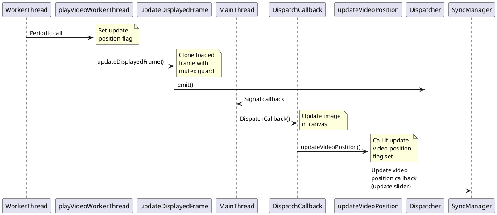
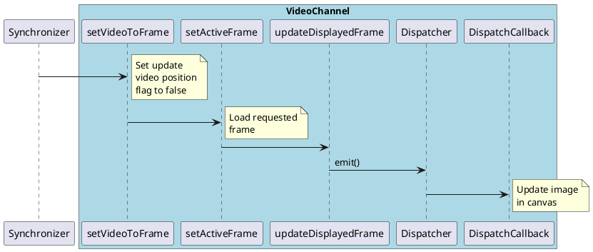
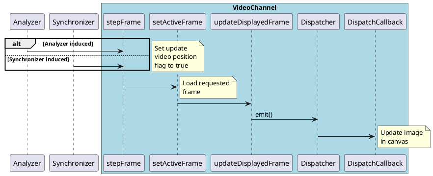

# Overview

The video channel frame update can occur through the following mechanisms:
- Internal playback
- User initiated frame step
- User initiated slider drag

The update pathway for each of these is shown below

## Redesign

This can be simplified based on the differences between internally triggered (continuous playback), which requires thread-safe handling of the frame update, and externally triggered (setting specific frame) updates, which does not.

New approach
- Internal update from playback
    - Worker function
        - Clone frame
        - Emit to dispatcher
        - Load next frame into the frame buffer
    - Dispatcher callback
        - Copy frame buffer into display frame with mutex guard
        - Call updatePixBuf (new function) to load the display frame into the canvas image
- External callback
    - stepFrame and setVideoToFrame are public functions that call setActiveFrame
    - setActiveFrame will load the desired frame into the display frame
    - Call updatePixBuf to load the display frame into the canvas image

Eliminated functions:
- updateDisplayedFrame
- updateVideoPosition
- setVideoPosition

I don't believe the `VideoChannel::updateVideoPosition` function is needed. This function really does two completely different things, it either updates the active frame displayed based a on a floating point video position value, or it triggers the `SyncManager` video position update callback.

We should just trigger the slider update callback from `updateVideoPosition`.

## Internal playback

In internal playback, the displayed frame is updated periodically. In this sequence, the update video position flag will be true so that each frame update is relayed back to the Synchronizer to update the slider position.

## Slider drag

The slider drag is handled in the synchronizer, which calculates the index of the frame that the video should be at. It triggers the video channel to load that frame. Here the update video position flag will be false so that we don't trigger a slider update (e.g. there is no call to `updateVideoPosition`).

## Frame step

Frame step is similar to slider drag in that the displayed frame is manually adjusted based on external request. In this case we get an offset rather than an absolute index. Here we do trigger a slider update (e.g. update video position flag is true).

Right now frame steps can come from the Analyzer (in sync mode, requests come right from the buttons on the GUI) or the Synchronizer (in playback mode, step requests go to the Synchronizer and are then sent to both channels).

