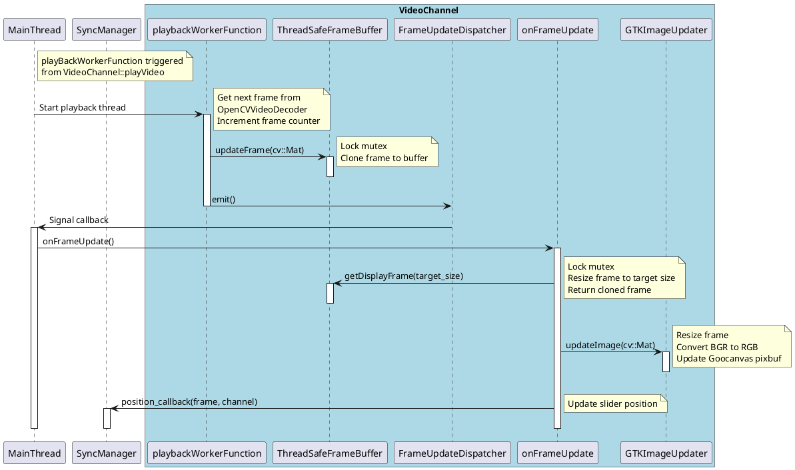
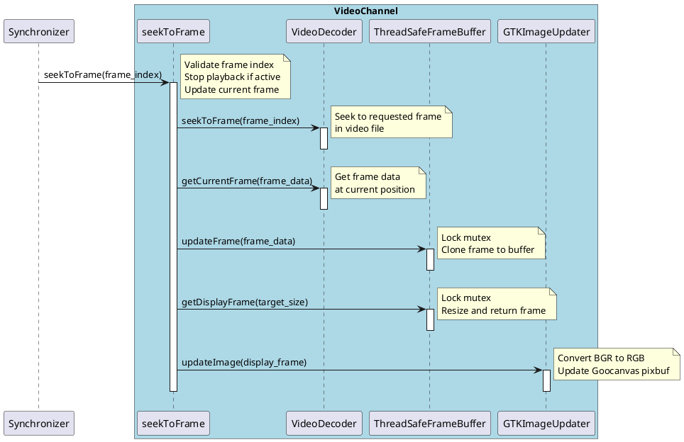
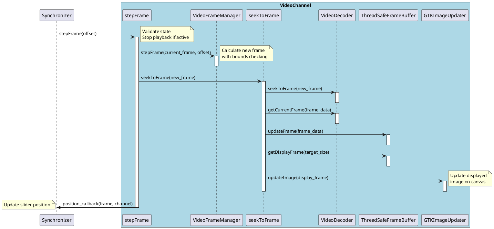

# Overview

Video channel frame update is the process of retrieving and displaying a new video frame. The frame update process can occur through the following mechanisms:
- **Internal playback**: Background thread managed by `VideoPlaybackController` with thread-safe frame buffer for continuous video playback at desired frame rate
- **User initiated frame step**: Frame stepping with bounds checking via `VideoFrameManager`  
- **User initiated slider drag**: Direct frame seeking through `Synchronizer`

The update pathway for each mechanism involves the modular VideoChannel architecture relying on components `OpenCVVideoDecoder`, `ThreadSafeFrameBuffer`, `GTKImageUpdater`, and `VideoFrameManager`.

Note that we use the term **frame update** to represent the process of the video channel retrieving and displaying a new frame. This is distinct from the **video position update**, which refers to the user-initiated seeking within the video channels (e.g. via scroll bar drag).

## Internal playback

In internal playback, the displayed frame is updated periodically by a background thread managed by the `VideoPlaybackController`. `VideoChannel::playbackWorkerFunction` runs in an independent thread, looping at the desired framerate. In each loop iteration, it will retrieve the next frame from the `OpenCVVideoDecoder`, store it in a thread-safe frame buffer, and signal the main thread via a `Glib::Dispatcher` to update the GUI. The main thread processes the frame through the `onFrameUpdate` dispatcher callback. In the callback, it retrieves the frame from the thread-safe buffer, resizes it as needed, and updates the GTK canvas image. At each frame update, a position callback to the `SyncManager` is triggered to update the slider as well to maintain synchronization between the video position and the GUI components (e.g. scrollbars).

## Externally Triggered Updates

There are two paths to update the displayed frame: stepping by an offset, and setting the active frame index directly (e.g. seeking). Both use the same underlying mechanism involving the `seekToFrame` method, which validates the frame index, seeks to the frame in the video decoder, retrieves the frame data, updates the thread-safe frame buffer, and then updates the GUI display through the `GTKImageUpdater`. These operations are performed synchronously in the main thread.

### Slider Drag (Seek)

The slider drag is handled by the `Synchronizer`, which calculates the index of the frame that the video should be at based on the slider position. It calls the video channel's `seekToFrame` method, which loads the requested frame and updates the display. See <a href="Scroll bar synchronization.md">scroll bar synchronization</a> for details on how the scroll bar is kept synchronized to the video position during playback and seeking.

### Frame step

Here we step the frame by the provided offset using the `VideoFrameManager` to calculate the new frame index with bounds checking, then call `seekToFrame` to load and display the new frame. This triggers a slider update at the end through the position callback.

