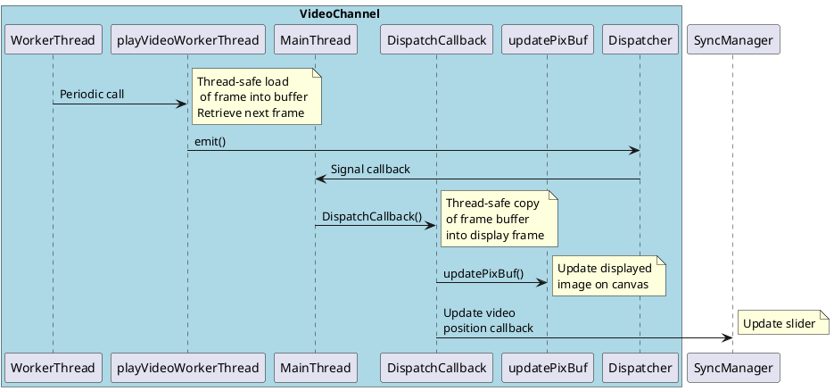
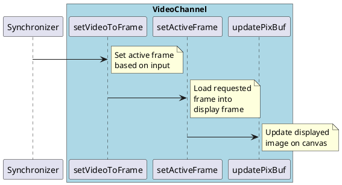
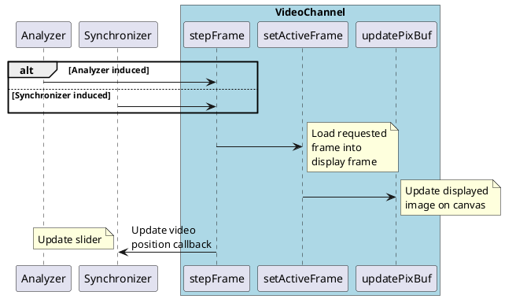

# Overview

The video channel frame update can occur through the following mechanisms:
- Internal playback
- User initiated frame step
- User initiated slider drag

The update pathway for each of these is shown below

## Internal playback

In internal playback, the displayed frame is updated periodically. We use a mutex to transfer the newly captured frame through a frame buffer to the displayed frame object, where it is then used to update the canvas image. At each frame update, we trigger a slider position update.

## Externally triggered updates

There are two paths to update the displayed frame: stepping by an offset, and setting the active frame index directly. These are very similar pathways that involve setting the frame index, retrieving the corresponding frame, and then updating the display. These operations are performed in a single thread, simplifying the data management.

### Slider drag

The slider drag is handled in the synchronizer, which calculates the index of the frame that the video should be at. It triggers the video channel to load that frame. Since the update came from the slider itself, we do not trigger a slider position update.

### Frame step

Here we step the frame by the provided offset, triggering a slider update at the end.

Right now frame steps can come from the Analyzer (in sync mode, requests come right from the buttons on the GUI) or the Synchronizer (in playback mode, step requests go to the Synchronizer and are then sent to both channels).

