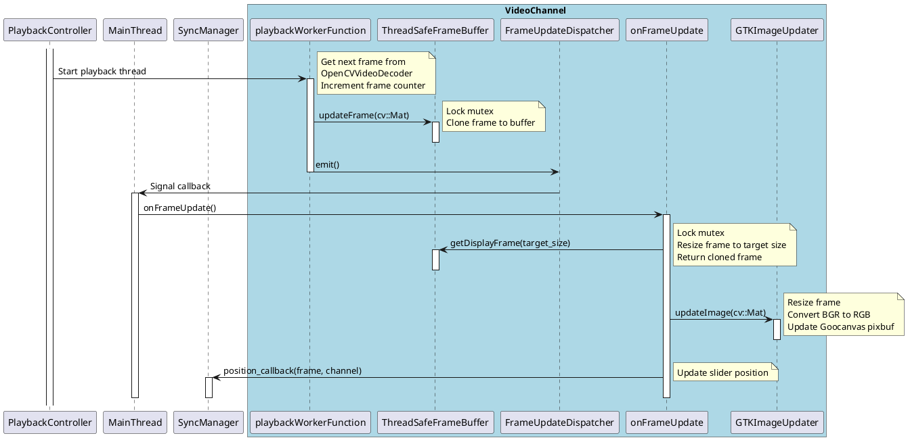
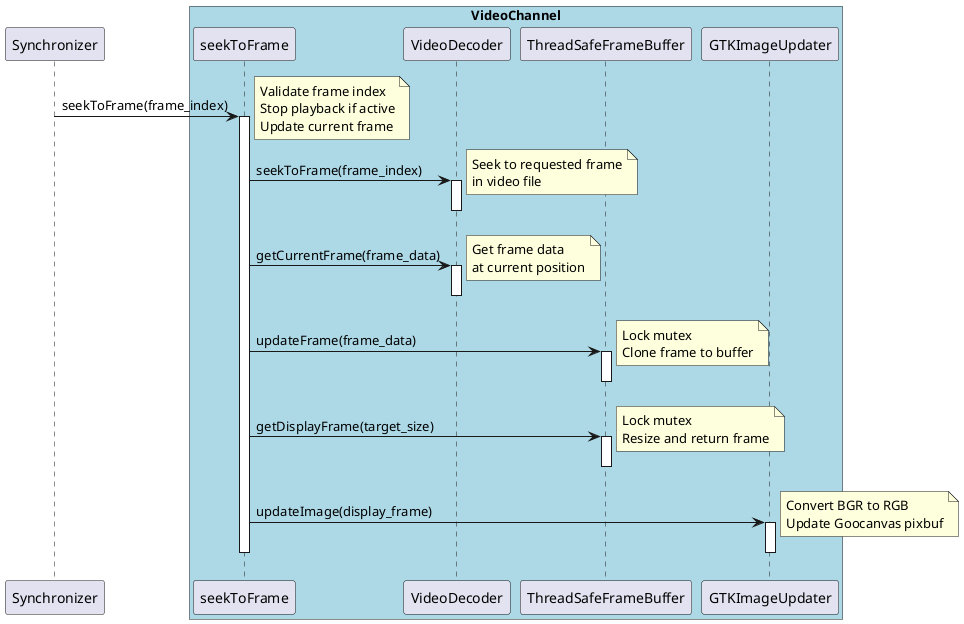
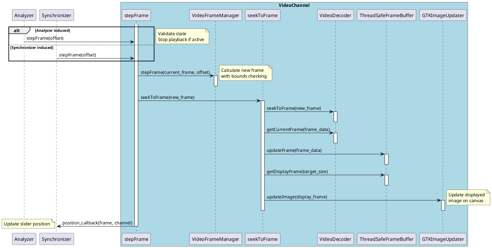

# Overview

Video channel frame update is the process of retrieving and displaying a new video frame. The frame update process can occur through the following mechanisms:
- **Internal playback**: Background thread managed by `VideoPlaybackController` with thread-safe frame buffer for continuous video playback at desired frame rate
- **User initiated frame step**: Frame stepping with bounds checking via `VideoFrameManager`  
- **User initiated slider drag**: Direct frame seeking through `Synchronizer`

The update pathway for each mechanism involves the modular VideoChannel architecture with components like `OpenCVVideoDecoder`, `ThreadSafeFrameBuffer`, `GTKImageUpdater`, and `VideoFrameManager`.

## Internal playback

In internal playback, the displayed frame is updated periodically by a background thread managed by the `VideoPlaybackController`. The `playbackWorkerFunction` runs in an independent thread, retrieves frames from the `OpenCVVideoDecoder`, stores them in a thread-safe frame buffer, and then signals the main thread via a `Glib::Dispatcher` to update the GUI. The main thread processes the frame through the `onFrameUpdate` dispatcher callback, which retrieves the frame from the buffer, resizes it, and updates the GTK canvas image. At each frame update, a position callback is triggered to update the slider as well to maintain synchronization.

## Externally triggered updates

There are two paths to update the displayed frame: stepping by an offset, and setting the active frame index directly. Both use the same underlying mechanism involving the `seekToFrame` method, which validates the frame index, seeks to the frame in the video decoder, retrieves the frame data, updates the thread-safe frame buffer, and then updates the GUI display through the `GTKImageUpdater`. These operations are performed synchronously in the main thread.

### Slider drag

The slider drag is handled by the `Synchronizer`, which calculates the index of the frame that the video should be at based on the slider position. It calls the video channel's `seekToFrame` method, which loads the requested frame and updates the display. Since the update originated from the slider itself, no slider position update is triggered to avoid feedback loops.

### Frame step

Here we step the frame by the provided offset using the `VideoFrameManager` to calculate the new frame index with bounds checking, then call `seekToFrame` to load and display the new frame. This triggers a slider update at the end through the position callback.

Right now frame steps can come from the Analyzer (in sync mode, requests come directly from the buttons on the GUI) or the Synchronizer (in playback mode, step requests go to the Synchronizer and are then sent to both channels).

