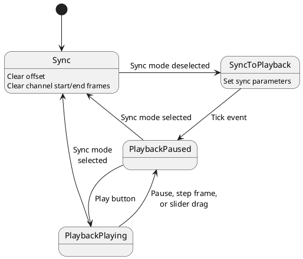
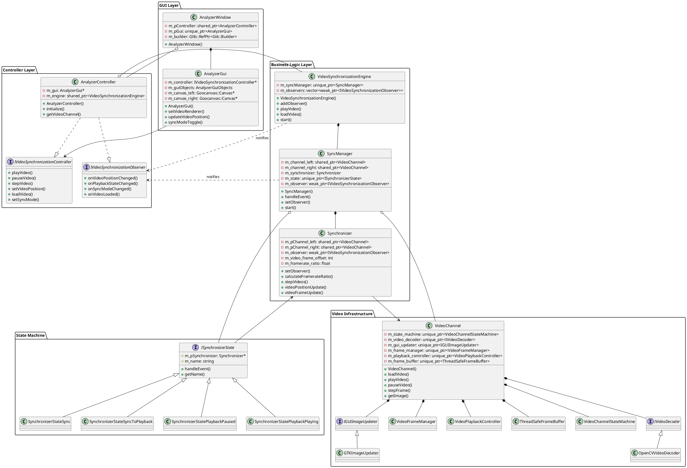
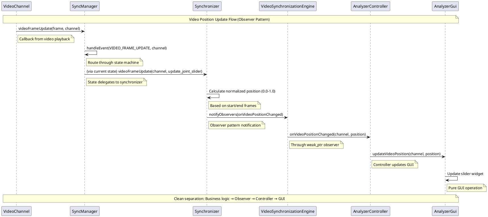
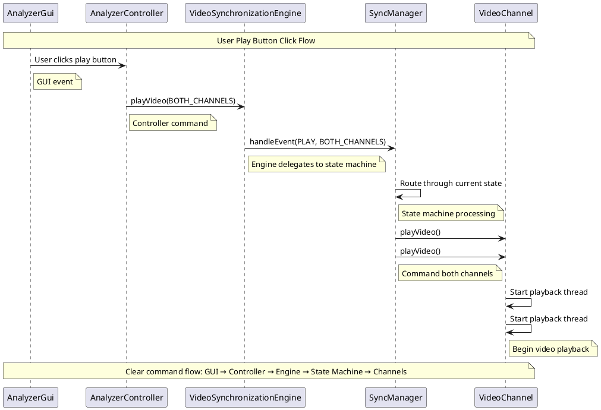

# Synchronization and playback

## Synchronization theory of operations

The video synchronization system enables users to time-align two video channels (left and right) and then play them back with events synchronized between the two. The system is built around four core components that work together: the **VideoSynchronizationEngine**, **SyncManager**, **Synchronizer**, and **VideoChannel** classes.

### Component Overview

**VideoSynchronizationEngine** serves as the top-level business logic coordinator that:
- Manages observer pattern for GUI notifications
- Coordinates high-level video synchronization operations
- Provides clean interface for controller layer integration
- Delegates state management to SyncManagerCreate system architecture class diagramthat:
- Owns two `VideoChannel` instances (left and right) using shared_ptr
- Implements a state machine to manage sync and playback modes
- Routes events to the appropriate state handlers
- Manages observer notifications for video position changes

**Synchronizer** manages the synchronization logic and data:
- Calculates frame offsets between video channels
- Handles framerate differences between videos
- Manages synchronized playback parameters
- Uses observer pattern for GUI updates instead of direct calls

**VideoChannel** handles individual video playback with a modular architecture:
- **Core Components**:
  - `VideoChannelStateMachine`: Manages state transitions (UNLOADED/STOPPED/PLAYING)
  - `IVideoDecoder`/`OpenCVVideoDecoder`: Handles video file loading and frame extraction
  - `IGUIImageUpdater`/`GTKImageUpdater`: Manages GUI image display updates
  - `VideoFrameManager`: Handles frame range validation and navigation
  - `VideoPlaybackController`: Controls playback timing and threading
  - `ThreadSafeFrameBuffer`: Provides thread-safe frame data management

### Synchronization Process

The synchronization process occurs in two distinct phases:

#### 1. Sync Mode (Manual Alignment)
When the system is in sync mode, users can independently control each video channel to establish the desired temporal alignment:

- **Individual Control**: Each video channel responds directly to its own set of controls (frame stepping, slider positioning)
- **Independent Positioning**: Users can set each video to different frame positions to align specific events (e.g., golf ball contact)
- **No Offset Calculation**: The system tracks current frame positions but does not yet calculate or apply any synchronization offset
- **GUI State**: Individual channel controls are enabled, while combined playback controls are disabled

#### 2. Transition to Playback Mode (Offset Calculation)
When transitioning from sync mode to playback mode, the system calculates and locks in the synchronization:

- **Offset Calculation**: The system determines the frame offset using the formula:
  ```
  offset = (left_active_frame - left_start_frame) - (right_active_frame - right_start_frame)
  ```
- **Start Frame Adjustment**: Based on the calculated offset:
  - If offset > 0: Left channel start frame is advanced by the offset amount
  - If offset < 0: Right channel start frame is advanced by the absolute offset amount
- **Length Determination**: The system calculates the effective playable length of each channel and uses the shorter length as the combined playback length
- **Master Channel Selection**: The channel with the shorter effective length becomes the master for GUI slider updates

#### 3. Synchronized Playback Mode
Once synchronization parameters are established, the system maintains perfect alignment:

- **Framerate Compensation**: If videos have different framerates, the system calculates a framerate ratio and applies proportional frame stepping
- **Coordinated Control**: All playback operations (play, pause, step, seek) are applied to both channels with appropriate scaling
- **Unified GUI**: The combined slider controls both videos simultaneously, with position updates coming from the designated master channel
- **Boundary Enforcement**: Both videos are constrained to play within their calculated synchronized ranges

### Frame Update Mechanism

The system uses an observer pattern approach to maintain GUI synchronization:

1. **Video Channel Callbacks**: Each `VideoChannel` is configured with a callback function that triggers when its active frame changes during playback
2. **State Machine Routing**: The `SyncManager` receives these callbacks and routes them through the current state's event handler
3. **Synchronizer Processing**: The `Synchronizer` calculates the normalized position (0.0 to 1.0) based on the channel's start/end frames
4. **Observer Notifications**: The `Synchronizer` notifies registered observers through the `IVideoSynchronizationObserver` interface
5. **Controller Mediation**: The `AnalyzerController` receives observer notifications and updates the GUI through `AnalyzerGui`
6. **GUI Updates**: The `AnalyzerGui` updates the appropriate slider(s) based on the received position information

This observer-based approach provides clean separation between business logic and GUI layers.

### Framerate Handling

When videos have different framerates, the system maintains temporal synchronization:

- **Ratio Calculation**: `framerate_ratio = left_fps / right_fps`
- **Proportional Stepping**: Frame step operations are scaled by the framerate ratio
- **Temporal Alignment**: Videos advance at rates proportional to their framerates to maintain synchronized timing

This architecture ensures that regardless of the source videos' framerates or the user's initial alignment choices, the synchronized playback maintains perfect temporal coordination between the two video channels.

# Synchronizer state diagram

## Overview

From the user perspective, the system is either in synchronization mode, where the user can adjust the offset between the two channels, or the playback mode, where the synchronized videos are played or otherwise manipulated via frame stepping or slider dragging using the individual channel controls to time sync the two channels. These two modes actually break down into four states implemented by the synchronizer state machine as described in the below diagram and the notes that follow.

## Diagram



## Notes

- `SyncToPlayback` state
    - On entry to this state, we establish the synchronization between the two video channels
    - We determine the offset between the two as the difference in the delta from the start frame to the active frame
    - We then update the start frame for one channel or the other according to the offset
    - This state exists only to execute the state entry actions, we transition to the `PlaybackPaused` state on a tick event, where the tick event is always executed after any state transition.
- `Sync` state
    - On entry to this state, we clear the synchronization settings, that is we set the offset to zero and reset the start and end frames

## Events

The table below describes the events handled by the state machine. Each event includes a channel selection (left, right, both, or none). There may also be data associated with the event that is processed through the sync manager.

| Event | Description | Associated data | Handling in sync mode | Handling in playback mode |
|-------|-------------|-----------------|-----------------------|---------------------------|
| `TICK` | Artificially injected event after each state transition | N/A | Calculate sync parameters | N/A |
| `PLAY_OR_PAUSE` | Request to play (if paused) or pause (if playing) video(s) | N/A | If both channels are paused, then play both, otherwise pause both | Pause videos if playing, and vice versa |
| `PLAY` | Request to play video(s) | N/A | Play both video channels | Play both video channels |
| `PAUSE` | Request to pause video(s) | N/A | Pause both video channels | Pause both video channels |
| `SYNC_ON` | Request to enter sync mode | N/A | N/A | Transition to sync mode |
| `SYNC_OFF` | Request to enter playback mode | N/A | Transition to playback mode (via `SyncToPlayback`) | N/A |
| `PLAYBACK_COMPLETE` | Video channel indicating playback is complete | N/A | Do nothing (videos will start from beginning on next playback) | Restore videos to start position and pause |
| `STEP_FORWARD_LARGE` | Request to step video(s) forward by 5 frames | N/A | Pause playback and step video | Pause playback and step videos |
| `STEP_FORWARD_SMALL` | Request to step video(s) forward by 1 frame | N/A | Pause playback and step video | Pause playback and step videos |
| `STEP_BACKWARD_LARGE` | Request to step video(s) backward by 5 frames | N/A | Pause playback and step video | Pause playback and step videos |
| `STEP_BACKWARD_SMALL` | Request to step video(s) backward by 1 frame | N/A | Pause playback and step video | Pause playback and step videos |
| `SET_VIDEO_TO_START` | Request to set video(s) to start position | N/A | N/A | Set video to start |
| `PLAYBACK_RATE_UPDATE` | Request to update the playback rate | Desired playback rate multiplier | Pause videos and update video channel playback rate | Pause videos and update video channel playback rate |
| `VIDEO_POSITION_UPDATE` | Request to set the video to desired position | Float position between 0.0 (start) and 1.0 (end) | Pause video and update active frame | Pause videos and update active frames |
| `VIDEO_FRAME_UPDATE` | Video channel playback has stepped forward by one frame | Integer frame index | Update GUI slider position | Update GUI slider position |
| `LOAD_VIDEO` | Request to load a new video file | Path of video file to load | Attempt to load new video file | Attempt to load new video file |

# Synchronizer class diagram

## Description

The classes involved in synchronization are:

**GUI Layer:**
- `AnalyzerWindow` extends `Gtk::Window` and represents the main application window
- `AnalyzerGui` provides pure GUI management focused on GTK widget handling and user interface components

**Controller Layer:**
- `AnalyzerController` implements both `IVideoSynchronizationController` and `IVideoSynchronizationObserver` interfaces
  - Mediates between GUI events and business logic using dependency injection
  - Provides clean separation of concerns between presentation and business logic through observer pattern implementation

**Business Logic Layer:**
- `VideoSynchronizationEngine` serves as the main business logic coordinator
  - Manages observer pattern for loose coupling with GUI layer
  - Coordinates high-level video synchronization operations
  - Provides clean interface for controller integration
- `SyncManager` is the state machine orchestrator for video playback and synchronization
  - Owns video channels using shared_ptr ownership model to share with `Synchronizer`
  - Routes events through the synchronization state machine
  - Manages observer notifications for position updates
- `Synchronizer` manages the core synchronization logic and data
  - Calculates frame offsets and handles framerate differences
  - Uses observer pattern to route event information to the GUI
  - Friend classes with SyncManager and synchronization state machine states for controlled access

**State Machine:**
- `ISynchronizerState` implements the interface for state machine states
  - Provides access to Synchronizer and logger for state implementations
  - Contains state name and event handling interface
  - The concrete states implemented are:
    - `SynchronizerStateSync`: Independent video channel control for manual alignment
    - `SynchronizerStateSyncToPlayback`: Transition state for offset calculation and parameter setup
    - `SynchronizerStatePlaybackPaused`: Synchronized playback in paused state
    - `SynchronizerStatePlaybackPlaying`: Synchronized playback in playing state

**Video Infrastructure:**
- `VideoChannel` implements the logic for loading and playback of a single video channel
  - Uses state machine (`VideoChannelStateMachine`) for clean state management
  - Delegates video decoding to `IVideoDecoder` interface (implemented by `OpenCVVideoDecoder`)
  - Delegates GUI updates to `IGUIImageUpdater` interface (implemented by `GTKImageUpdater`)
  - Uses helper classes for frame management, playback control, and thread-safe buffering

## Diagram



## Video Position Update Sequence

The following sequence diagram shows how video position updates flow through the new observer-based architecture:



## User Interaction Sequence

The following sequence diagram shows how user interactions flow from GUI to business logic:

