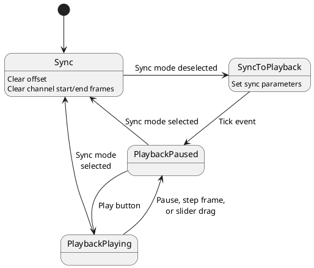
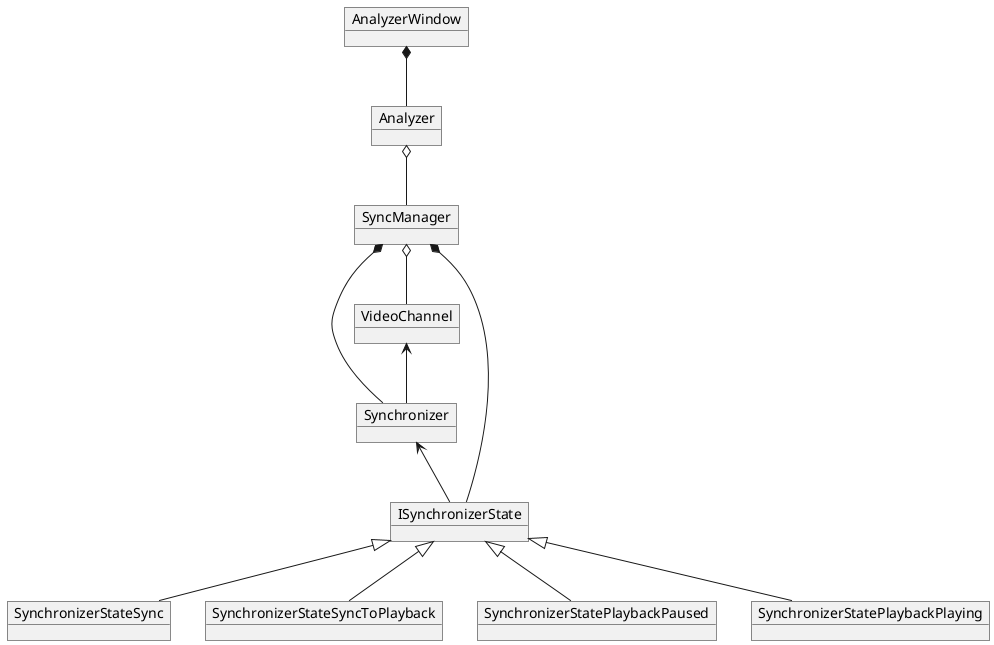

# Synchronizer state diagram

## Overview

From the user perspective, the system is either in synchronization mode, where the user can adjust the offset between the two channels, or the playback mode, where the synchronized videos are played or otherwise manipulated via frame stepping or slider dragging using the individual channel controls to time sync the two channels. These two modes actually break down into four states implemented by the synchronizer state machine as described in the below diagram and the notes that follow.

## Diagram

## Notes

- `SyncToPlayback` state
    - On entry to this state, we establish the synchronization between the two video channels
    - We determine the offset between the two as the difference in the delta from the start frame to the active frame
    - We then update the start frame for one channel or the other according to the offset
    - This state exists only to execute the state entry actions, we transition to the `PlaybackPaused` state on a tick event, where the tick event is always executed after any state transition.
- `Sync` state
    - On entry to this state, we clear the synchronization settings, that is we set the offset to zero and reset the start and end frames

## Events

The table below describes the events handled by the state machine. Each event includes a channel selection (left, right, both, or none). There may also be data associated with the event that is processed through the sync manager.

| Event | Description | Associated data |
|-------|-------------|-----------------|
| `TICK` | Artificially injected event after each state transition | N/A |
| `PLAY_OR_PAUSE` | Request to play (if paused) or pause (if playing) video(s) | N/A |
| `PLAY` | Request to play video(s) | N/A |
| `PAUSE` | Request to pause video(s) | N/A |
| `SYNC_ON` | Request to enter sync mode | N/A |
| `SYNC_OFF` | Request to enter playback mode | N/A |
| `PLAYBACK_COMPLETE` | Video channel indicating playback is complete | N/A |
| `STEP_FORWARD_LARGE` | Request to step video(s) forward by 5 frames | N/A |
| `STEP_FORWARD_SMALL` | Request to step video(s) forward by 1 frame | N/A |
| `STEP_BACKWARD_LARGE` | Request to step video(s) backward by 5 frames | N/A|
| `STEP_BACKWARD_SMALL` | Request to step video(s) backward by 1 frame | N/A |
| `SET_VIDEO_TO_START` | Request to set video(s) to start position | N/A |
| `PLAYBACK_RATE_UPDATE` | Request to update the playback rate | Desired playback rate multiplier |
| `VIDEO_POSITION_UPDATE` | Request to set the video to desired position | Float position between 0.0 (start) and 1.0 (end) |
| `VIDEO_FRAME_UPDATE` | Video channel playback has stepped forward by one frame | Integer frame index |
| `LOAD_VIDEO` | Request to load a new video file | Path of video file to load |

# Synchronizer class diagram

## Description

The classies involved in synchronization are:
- `AnalyzerWindow` extends `Gtk::Window` and represents the GUI window itself
- `Analyzer` provides an interface that encapsulates the GTK GUI implementation
- `SyncManager` is the top level implementation of the video playback and synchronization functionality
    - GUI events are passed from the `Analyzer` to the `SyncManager`, and then handled through the synchronization state machine
        - In some cases, data from the event are passed directly from `SyncManager` to `Synchronizer`
        - If needed, the event handler within the state then triggers a function call to `Synchronizer` to process the provided data
    - Likewise, where events during video playback require action in the GUI, e.g. video playback triggering update of the position sliders, these are passed through `SyncManager` to the `Analyzer`
- `Synchronizer` manages the state data related to the synchronization between the two channels, and implements methods for manipulation of the data
    - The `SyncManager` and the individual states are declared as friend classes to the `Synchronizer`
- `ISynchronizerState` implements the interface to the state machine state implmentation
    - Member variables accessible to the subclasses include a pointer to the `Synchronizer` and the logger
    - There is also a protected member variable for the state name string, with an accessor function
    - The concrete states implemented are:
        - `SynchronizerStateSync`: the state representing sync mode of operation where the user can adjust the two video channels independently to time sync them
        - `SynchronizerStateSyncToPlayback`: this is used as a transition state between sync mode and playback mode, it is used to simply set the synchronization parameters and then will immediately transition to the playback (paused) mode
        - `SynchronizerStatePlaybackPaused`: this state represents the playback mode when the videos are paused
        - `SynchronizerStatePlaybackPlaying`: this state represents the playback mode when the videos are playing

## Diagram

