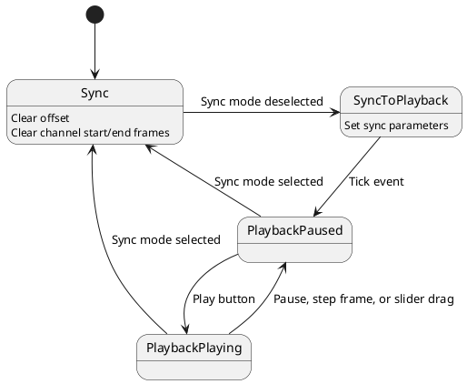
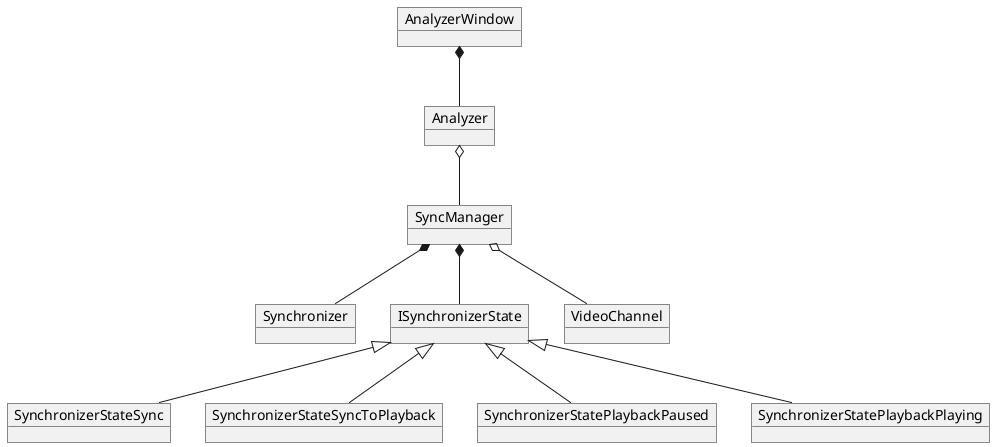

# Synchronizer state diagram

## Overview

From the user perspective, the system is either in synchronization mode, where the user can adjust the offset between the two channels, or the playback mode, where the synchronized videos are played or otherwise manipulated via frame stepping or slider dragging. These two modes actually break down into four states implemented by the synchronizer state machine as described in the below diagram and the notes that follow.

## Diagram

## Notes

- `SyncToPlayback` state
    - On entry to this state, we establish the synchronization between the two video channels
    - We determine the offset between the two as the difference in the delta from the start frame to the active frame
    - We then update the start frame for one channel or the other according to the offset
- `Sync` state
    - On entry to this state, we clear the synchronization settings, that is we set the offset to zero and reset the start and end frames

# Synchronizer class diagram

## Description

The classies involved in synchronization are:
- `AnalyzerWindow` extends `Gtk::Window` and represents the GUI window itself
- `Analyzer` provides an interface class to encapsulate the details of the GUI implementation
- `SyncManager` is the top level implementation of the video playback and synchronization functionality
    - GUI events are passed from the `Analyzer` to the `SyncManager`, and then handled through the state machine
        - In some cases, data from the event are passed directly from `SyncManager` to `Synchronizer`
        - The event handler within the state implmentation then triggers a function call to `Synchronizer` to process the provided data
    - Likewise, where events during video playback require action in the GUI, e.g. video playback triggering update of the position sliders, these are passed through `SyncManager` to the `Analyzer`
- `Synchronizer` manages the state data related to the synchronization between the two channels, and implements methods for manipulation of the data
- `ISynchronizerState` implements the interface to the state machine state implmentation
    - Member variables accessible to the subclasses include a pointer to the `Synchronizer` and the logger
    - There is also a protected member variable for the state name string, accessible through an accessor function
    - The concrete states implemented are:
        - `SynchronizerStateSync`: the state represented sync mode of operation where the user can adjust the two video channels independently to time-sync them
        - `SynchronizerStateSyncToPlayback`: this is used as a transition state between sync mode and playback mode, it is used to simply set the synchronization parameters and then will immediately transition to the playback (paused) mode
        - `SynchronizerStatePlaybackPaused`: this state represents the playback mode when the videos are paused
        - `SynchronizerStatePlaybackPlaying`: this state represents the playback mode when the videos are playing

## Diagram

